# explorer

**Agent skills that explain code and systems with real diagrams, not walls of text.**

Ask your coding agent to explain a codebase, a design or a decision, and get back one self-contained HTML page: diagrams drawn in the form that fits each idea (102 types, from sequence diagrams to ERDs to Wardley maps), highlighted tables you can filter and sort, interactive figures, a walk through the real files, and, for codebases, interview questions you can tick off. Or get a narrated video of the same figures. The agent draws every diagram as SVG, renders it in headless Chrome, looks at the result and fixes what it sees before you do.

[](LICENSE)
[](https://docs.claude.com/en/docs/claude-code)
[](https://skills.sh)
[](diagram-types/README.md)
[](#requirements)

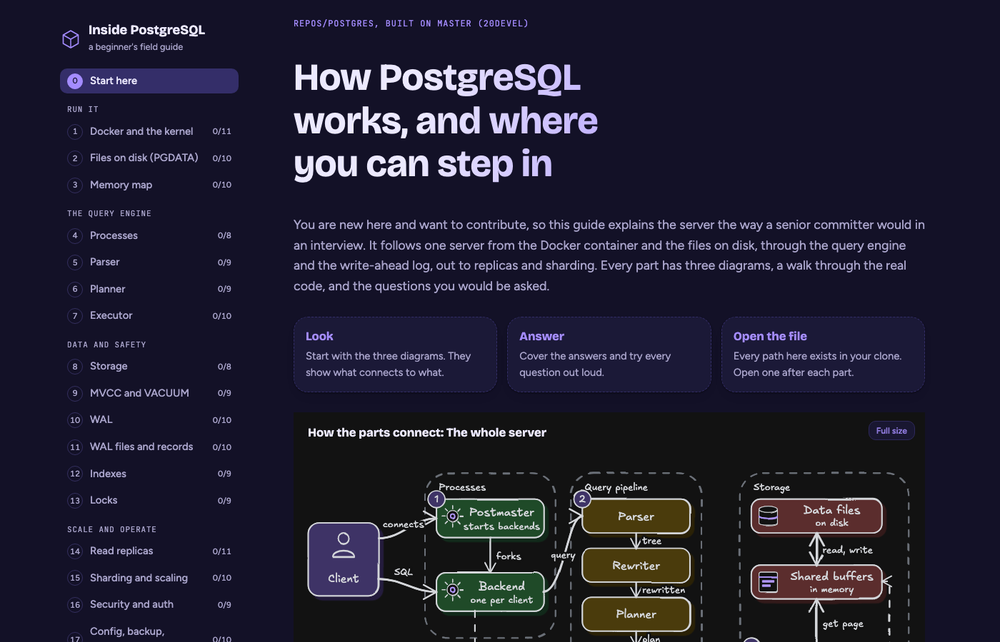

## Three skills, one diagram kit

| Skill | Say this to your agent | You get |
|---|---|---|
| [`codebase-explorer`](skills/codebase-explorer/SKILL.md) | "Build a field guide for this repo." | A multi-topic beginner guide: 3 diagrams per topic (how it connects, a numbered lifecycle, the anatomy), a walk through real files and functions, scrolling tables, 8 to 10 interview questions per topic, light and dark themes, hand-drawn or clean diagrams. |
| [`artifact-studio`](skills/artifact-studio/SKILL.md) | "Make an artefact explaining this design." | One shareable page, or a small multi-page site, for a single subject: a design doc, proposal, roadmap, review, comparison, investigation or report. Each figure is picked for the reader question it answers ([`choosing-diagrams.md`](skills/artifact-studio/references/choosing-diagrams.md)). Light theme, clean diagrams, highlighted tables with filters and sorting, interactive figures (hover focus, step-through, zoom and pan), repo maps, and detailed isometric figures through the [anatomy](https://github.com/wheresryan22/anatomy) skill; sites add an index, a shared nav, a section list per page and Previous / Next links. |
| [`artifact-studio-explainer`](skills/artifact-studio-explainer/SKILL.md) | "Create an explainer video about this." | A narrated 1920x1080 MP4 of the same figures. The Manim engine shows each real diagram full screen, steps through it, zooms into the part being explained and marks it with a red highlighter, with captions that follow the voice. |

All three use the same SVG diagram kit and the same [catalog of 102 diagram types](diagram-types/README.md), so a page and its video read like they were drawn by one person.

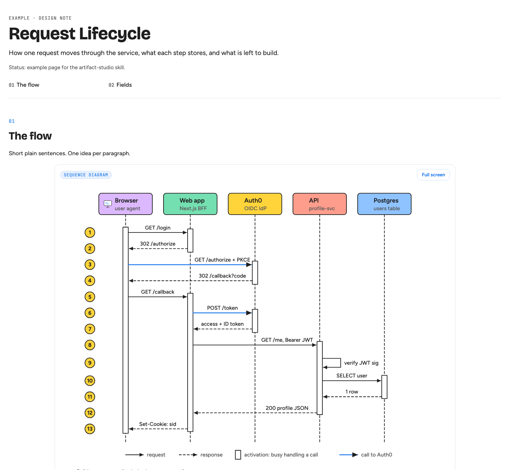

### One subject, four readers

The showcase page draws the explorer repo itself for four readers, with a different diagram type per question: a repo map, a sequence and a state machine for engineers; an isometric machine for the render loop (built with anatomy); a story map, a priority quadrant and a roadmap for product; a Wardley map and a waterfall for business.

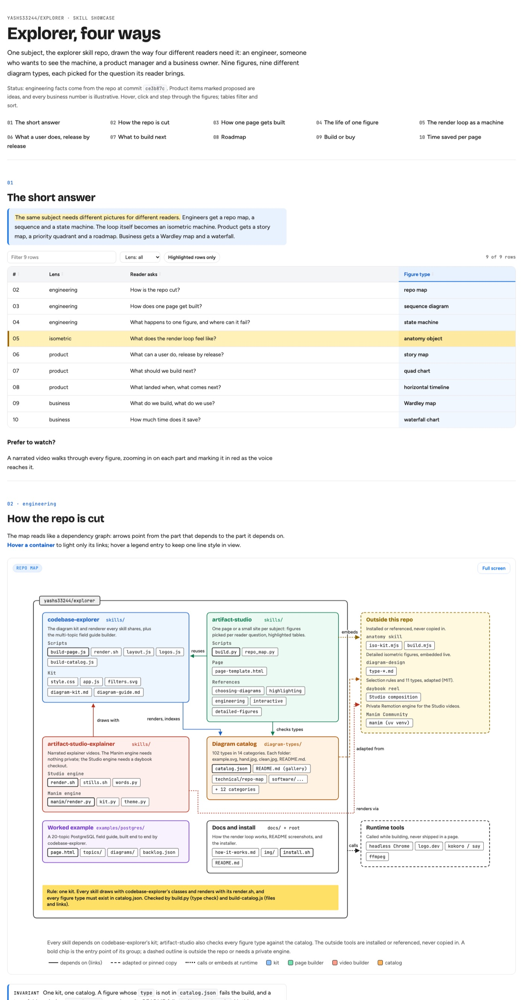

### Explainer videos that point at what they say

The video shows the page's own figures, sharp and full screen. As the voice reaches a part, the camera zooms to it and a red highlighter rings it, so a viewer always knows what is being explained.

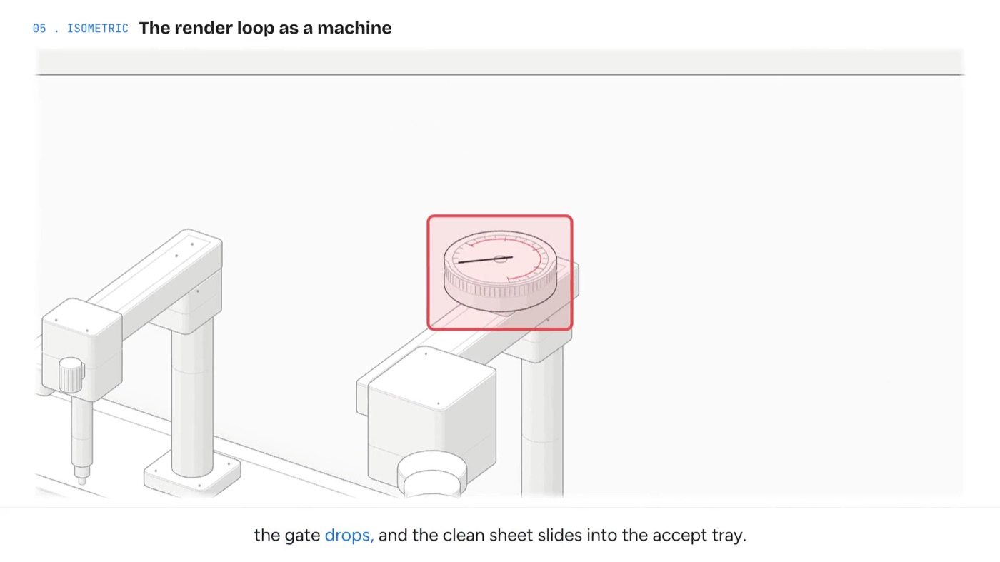

## Install

With the [skills CLI](https://skills.sh) (Claude Code, Cursor, Codex and other agents that read skills):

```bash
npx skills add yashs33244/explorer
```

Or clone and symlink into Claude Code's skills folder:

```bash
git clone https://github.com/yashs33244/explorer.git
cd explorer
./install.sh    # links each skill into ~/.claude/skills (override with CLAUDE_SKILLS_DIR)
```

Then just ask:

- "Use codebase-explorer to build a field guide for this repo."
- "Make an artefact that explains how our auth flow works, with diagrams."
- "Explain this migration plan as a one-page artifact with a timeline and a risk table."
- "Create an explainer video about how our build works."

## How it works

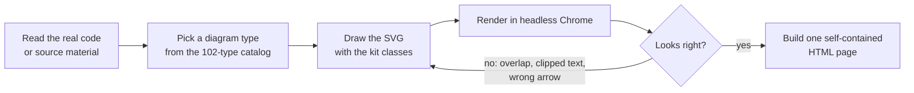

The part that matters is the loop. A model can write SVG that is valid but unreadable: labels on top of each other, an arrow pointing the wrong way, text running out of its box. Here every diagram is rendered to a PNG inside the real page CSS and the agent reads that image and repairs it, up to three rounds, before anything is published. [`docs/how-it-works.md`](docs/how-it-works.md) walks through the exact process behind the PostgreSQL example, including the second agent whose only job is to prove the first one wrong.

## The right diagram for the idea

Most generated docs draw everything as boxes and arrows. The catalog maps "what you are explaining" to a form: tiers become a layered architecture, calls over time become a sequence diagram, tables and keys become an ERD, a status field becomes a state machine, a folder layout becomes an annotated tree.

| | | |
|---|---|---|
| 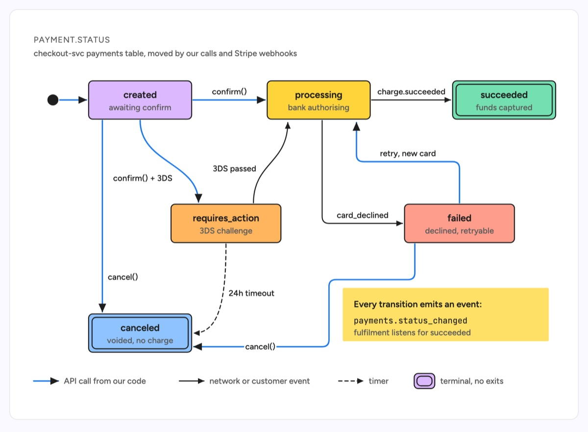 | 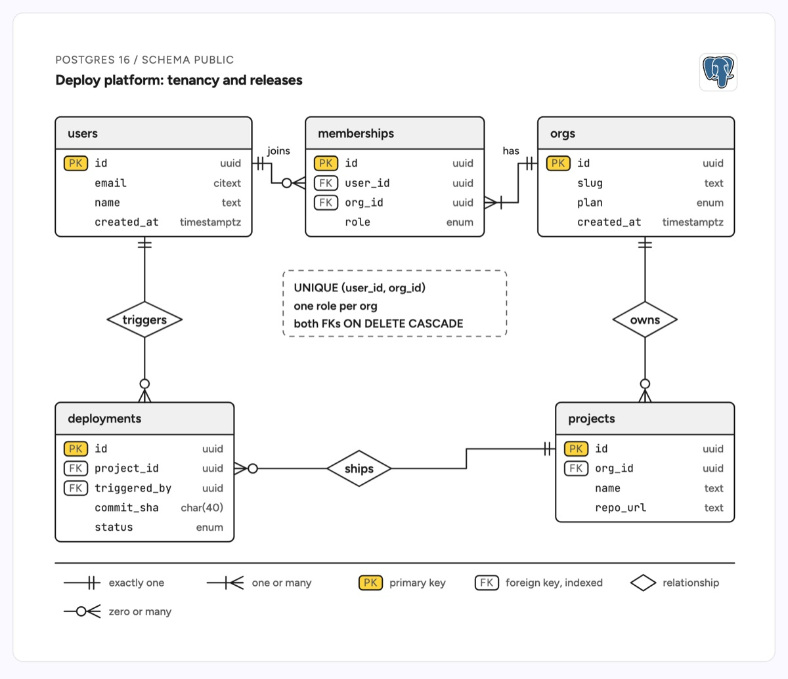 | 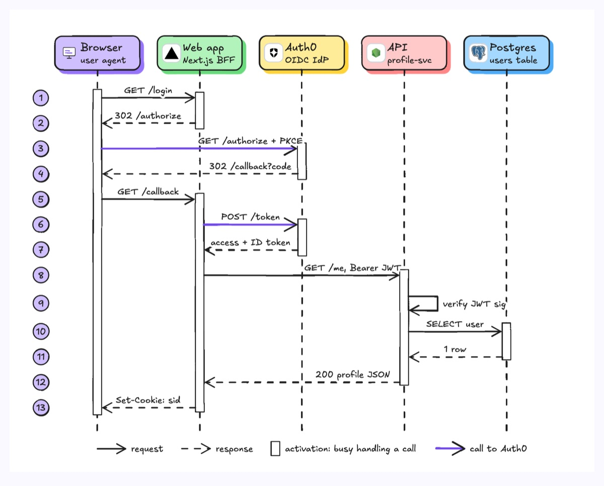 |
| State machine | ER diagram | Sequence diagram (hand-drawn) |
| 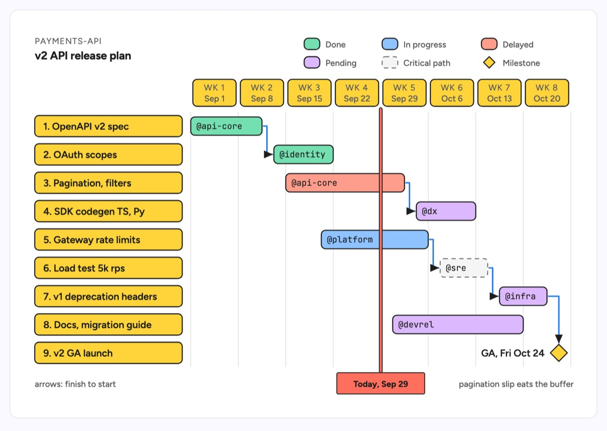 | 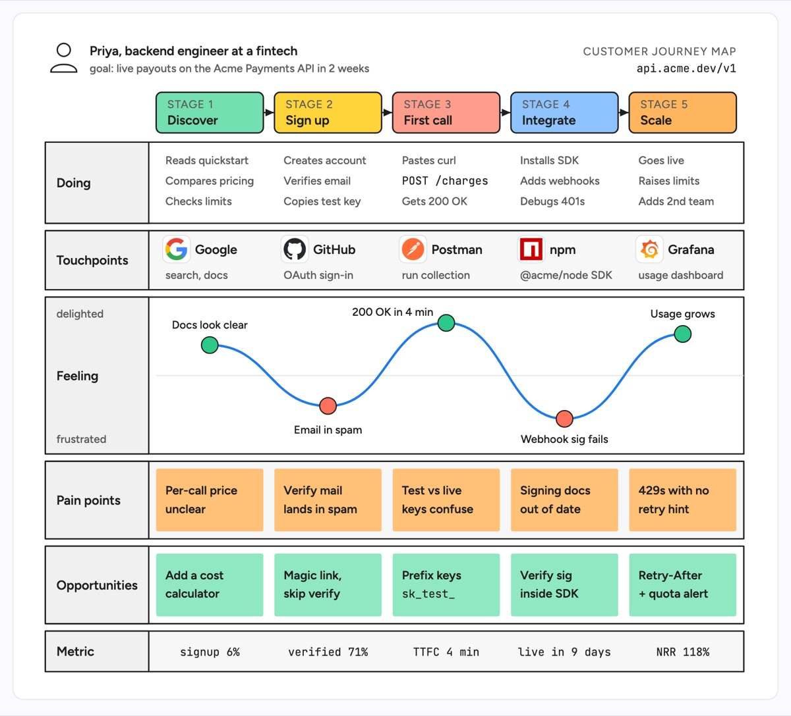 | 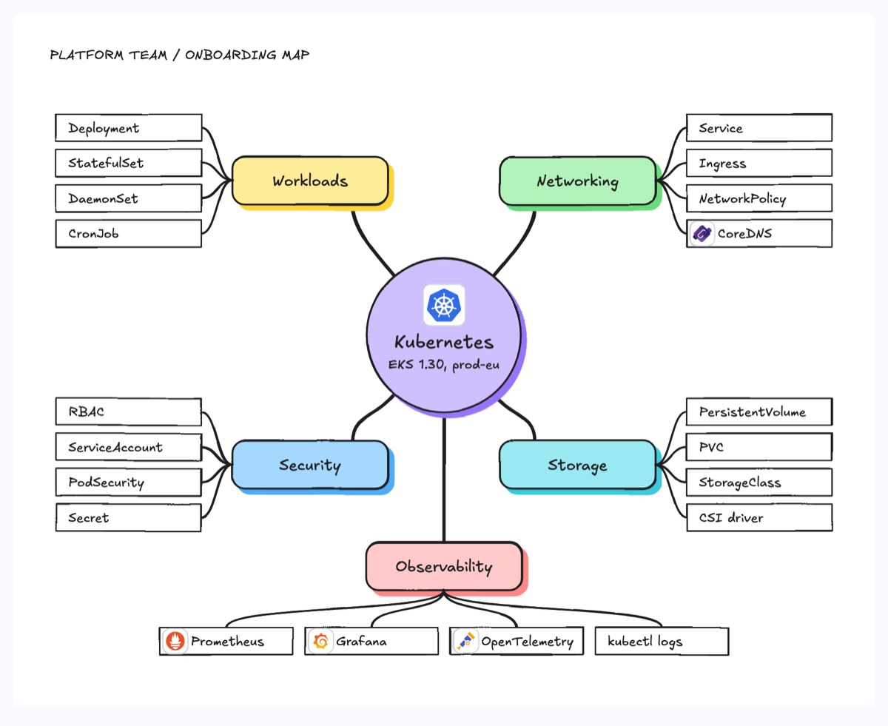 |
| Gantt chart | Customer journey | Mind map (hand-drawn) |

102 types in 14 categories: software, technical, mapping, process and workflow, data visualization, planning, customer and UX, design and content, org and hierarchy, education, business strategy, analysis, creative and admin. Every type folder has the source `example.svg`, a hand-drawn and a clean render, and a README with when to use it and its anatomy. Browse them in [`diagram-types/`](diagram-types/README.md). Ten of them (architecture delta, dependency graph, coverage matrix, story map, Wardley map, sankey, waterfall, line chart, treemap, fishbone) adapt types from [diagram-design](https://github.com/cathrynlavery/diagram-design) (MIT) to this kit.

## Why not just Mermaid?

Mermaid is great for quick diagrams in Markdown, and this README uses it. These skills aim at something else: a page a newcomer can learn from.

| | Mermaid in Markdown | explorer skills |
|---|---|---|
| Diagram forms | A fixed set of chart grammars | 102 hand-authored types, picked per idea |
| Layout control | Automatic | Exact: the agent places every box, label and badge |
| Styles | Theme colors | Hand-drawn and clean from the same SVG, light and dark |
| Product logos | No | Real logos via [logo.dev](https://logo.dev), monogram fallback |
| Quality check | None | Rendered, looked at and repaired by the agent |
| Output | Diagrams inside your docs | One self-contained HTML page with diagrams, tables, steps and questions |

## Try the examples

The PostgreSQL field guide (20 topics, 63 diagrams, 190 questions and a 37-row contribution backlog):

```bash
node skills/codebase-explorer/scripts/build-page.js \
  --config examples/postgres/explorer.config.json \
  --topics examples/postgres/topics \
  --diagrams examples/postgres/diagrams \
  --out examples/postgres/page.html
open examples/postgres/page.html
```

A minimal artifact-studio page (the screenshot above):

```bash
cd skills/artifact-studio/examples/basic
python3 ../../scripts/build.py --title "Request Lifecycle" \
  --body body.html --svg svg --figs figs.json --out /tmp/page.html
open /tmp/page.html
```

A multi-page site (an index with one card per page, a shared top nav, an "On this page" list per page, Previous / Next links) builds from a `site.json` that lists the pages; see [`SKILL.md`](skills/artifact-studio/SKILL.md) for the format:

```bash
python3 skills/artifact-studio/scripts/build.py --site site.json --out site/
open site/index.html
```

| Architecture | Lifecycle |
|---|---|
| 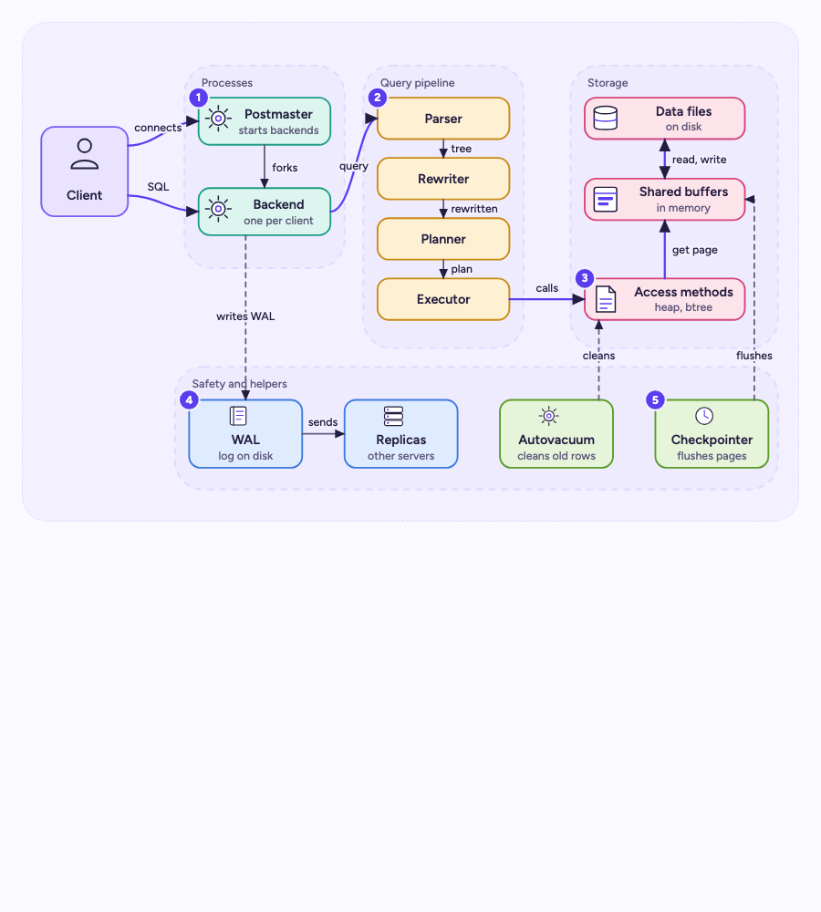 | 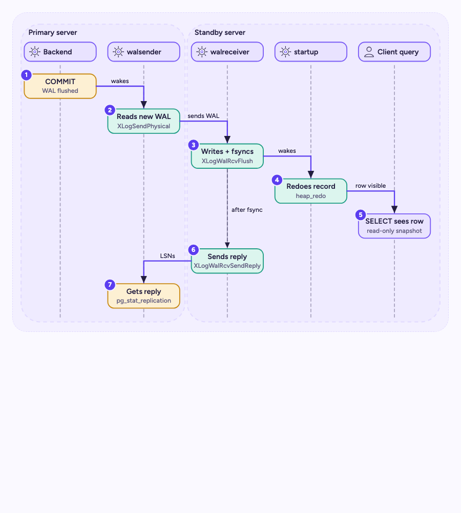 |

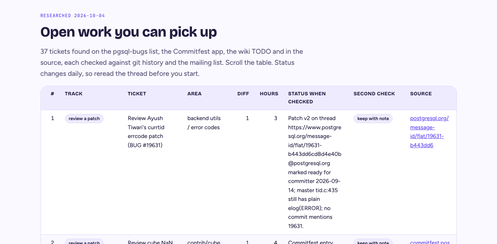

## Logos

Diagrams that name real products use logo slots (`<image class="d-logo" data-logo="postgresql.org">`). To fill them, get a free publishable key at [logo.dev](https://logo.dev) and keep it outside the repo:

```bash
mkdir -p ~/.config/explorer && printf 'LOGO_DEV_TOKEN=%s\n' 'pk_...' > ~/.config/explorer/logo-dev.env
```

Logos are fetched once, cached in `~/.cache/explorer-logos` and inlined as data URIs, so pages work offline. Without a key each slot becomes a monogram, and so does a project under a foundation domain such as `kafka.apache.org`, because Logo.dev answers those with the foundation's logo. The build warns when two domains return the same image. When the skill needs logos and no key is set, it asks you for one.

## Layout

```
skills/codebase-explorer/
  SKILL.md                 the skill (pipeline, quality bar, gotchas)
  scripts/build-page.js    JSON + SVG -> one HTML page (no dependencies)
  scripts/render.sh        render diagrams (hand or clean, png or jpg) and page sections in headless Chrome
  scripts/compare.sh       a reference image and our render side by side
  scripts/logos.js         fill logo slots from logo.dev, monogram fallback
  scripts/build-catalog.js regenerate the diagram-type gallery and chooser
  scripts/layout.js        automatic diagram fallback
  assets/                  style.css (page and diagram kit), app.js, icons.md, fonts/ (Excalifont license)
  references/              topic schema, diagram guide, diagram kit, diagram-type chooser, workflow template
skills/artifact-studio/
  SKILL.md                 the skill (one page or a small multi-page site, one subject)
  scripts/build.py         body.html + SVGs + figs.json -> one HTML page, or site.json -> index + one page per topic with nav, section list and Previous / Next; checks each figure type against the catalog and every link (Python standard library only)
  scripts/repo_map.py      JSON spec -> repo map SVG (nested containers, chips, three line styles)
  references/              choosing diagrams, highlighting, engineering pages, interactive figures, detailed (anatomy) figures, style guide, checklist
  assets/page-template.html light theme, wide and bleed figures, highlighted and filterable tables, interactive figures, Full screen with zoom and pan, site nav and section list
  examples/basic/          a minimal working page
diagram-types/             102 diagram types: example SVG, hand.jpg, clean.jpg, README
examples/postgres/         a complete field guide to learn from
skills/artifact-studio-explainer/
  SKILL.md                 the skill (storyboard, engines, pipeline)
  manim/setup.sh           one-time env: uv, Python 3.12, manim 0.22.0
  manim/render.py          storyboard -> voiced, captioned MP4 (the default Manim engine)
  manim/engine.py          layouts, build scheduling, one scene render
  manim/kit.py             chips, boxes, containers, edges, tables, caption bar
  manim/theme.py           artifact-studio tokens and fonts
  manim/figure.py          the figure layout: real SVG figures full screen, step, focus (zoom) and mark (red highlighter)
  manim/svgshot.py         SVG -> high-resolution PNG per data-step state, in the page CSS
  manim/fonts/             Figtree, Bricolage Grotesque, JetBrains Mono and their OFL licences
  manim/examples/demo/     a small working storyboard
  manim/GUIDE.md           storyboard format, layouts, actions and look rules
  references/              pointer to the storyboard formats
  scripts/, examples/cache the optional Studio engine and its example (needs a daybook reel checkout)
docs/how-it-works.md       how the diagrams and facts were produced
docs/adr/                  short records of settled design decisions
scripts/check.sh           the repo gate: catalog, example page, repo map example, syntax, no em dash
.claude-plugin/            plugin and marketplace manifest
```

## Requirements

- Node 18+ for `codebase-explorer`; Python 3 (standard library only) for `artifact-studio`.
- For explainer videos (Manim engine): `uv`, `ffmpeg`, `cairo` and `pango` (`brew install uv ffmpeg cairo pango pkgconf`), then `skills/artifact-studio-explainer/manim/setup.sh`, plus Chrome or Chromium for figures. The voice is kokoro through daybook reel when present, else macOS `say`, else `espeak-ng`; `--no-voice` makes a silent cut. Tested on macOS; Linux should work with Chrome or Chromium and espeak-ng, but is not tested. The optional Studio engine needs a daybook reel checkout.
- For isometric figures: the [anatomy](https://github.com/wheresryan22/anatomy) skill (`npx skills add wheresryan22/anatomy -g`), Node 20.10+.
- Google Chrome for diagram previews (`CHROME=/path/to/chrome` to override).
- `.jpg` renders also need `sips` (built into macOS) or ImageMagick (`magick`); `.png` renders need neither. `compare.sh` needs `uv`.
- The built pages have no runtime dependencies: one HTML file, fonts from Google Fonts, everything else inline.

## Honesty note

The PostgreSQL example's facts were read from the PostgreSQL source and checked by a second pass, and many commands were run against Homebrew PostgreSQL 16. The guide says so, and says which commands were not run. Function names move between releases, so confirm against the version you build. The skills carry the same rule: every file, function, number and command on a page is real, and anything unchecked is marked "not verified".

## Contributing

Run `scripts/check.sh` before you push; [`CONTRIBUTING.md`](CONTRIBUTING.md) has the details. New diagram types are the easiest way in:

1. Add `diagram-types/<category>/<slug>/example.svg` using only the kit classes ([`diagram-kit.md`](skills/codebase-explorer/references/diagram-kit.md)), plus a `README.md` with "Use it to explain" and an anatomy table. Copy an existing type as a template.
2. Render both styles: `skills/codebase-explorer/scripts/render.sh <example.svg> <hand.jpg> light hand` and the same with `clean`.
3. Regenerate the gallery and chooser: `node skills/codebase-explorer/scripts/build-catalog.js`.
4. Open a pull request with the two renders in the description.

Bug reports with a screenshot of a broken diagram are very welcome.

## License

The code and docs are MIT licensed. Two things inside the repo are not:

- The hand-drawn style inlines a Latin subset of Excalifont, Copyright (c) 2024 by Excalidraw, under the SIL Open Font License 1.1. Every built page carries it, so keep [`assets/fonts/Excalifont-OFL.txt`](skills/codebase-explorer/assets/fonts/Excalifont-OFL.txt) with any copy.
- Product logos in the diagrams and in the committed `diagram-types` renders are provided by [Logo.dev](https://logo.dev). They are trademarks of their owners, used only to name the products a diagram shows, and are not covered by the MIT license.

---

If these skills saved you an afternoon of drawing boxes, a star helps other people find them.
