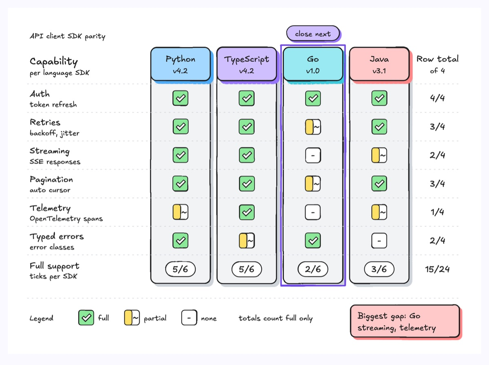
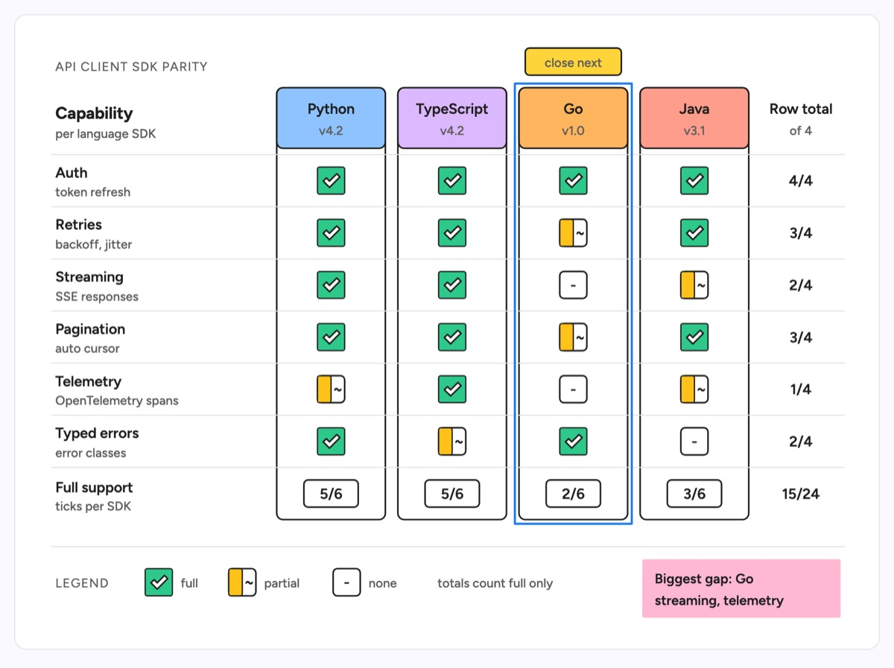

# Coverage matrix

A grid of items against capabilities where every cell holds one of three marks: full, partial or none. Each mark is drawn with shape and text, so it reads without colour. Row totals on the right and column totals along the bottom show where coverage is thin, and one accented column marks the target to close next. The example checks an API client SDK in Python, TypeScript, Go and Java against six capabilities: auth, retries, streaming, pagination, telemetry and typed errors. Go covers 2 of 6, and its biggest gaps are streaming and telemetry.

| Hand-drawn | Clean |
|---|---|
|  |  |

## Use it to explain

- Feature parity of an SDK, CLI or client across languages or platforms, and which one to bring up next.
- Gap analysis before a release: which capabilities each service, region or plan still lacks.
- Support or permission matrices: which roles can act on which components, or which versions support which features.

Not for: choosing between alternatives with a verdict (use `product-comparison`) or values over time (use `heat-map`).

## Anatomy

| Part | Class | Rule |
|---|---|---|
| Item column | `d-box` + `d-box g0`..`g5` header | One tall card per item, equal width, name in `d-t`, version or kind in `d-s` |
| Capability rows | `d-t`, `d-s`, `d-grid` | Name plus a 1 to 3 word scope, a thin rule between rows |
| Full mark | `d-fill g1` + `d-fillpaper` tick | Filled square with a tick |
| Partial mark | `d-tag` + half-width `d-fill g2` + `d-t` "~" | Outlined square, left half filled, tilde in the empty half |
| None mark | `d-tag` + `d-t` "-" | Empty outlined square with a dash |
| Totals | `d-t`, `d-tag` | Row total (out of items) on the right, column total pill at the bottom, grand total in the corner |
| Target column | `d-tag acc` + `d-edge acc` outline | At most one column, a short reason in the pill |
| Legend and note | `d-k`, `d-s`, `d-note` + `d-tn` | Legend strip under a rule; one note naming the biggest gap |

## Tips

- Keep the vocabulary closed: three states, each with its own shape and glyph. If a value is unknown, find out; do not invent a fourth "TBD" mark.
- Say what a total counts (here, full support only) so partial cells are not double counted, and check that row and column totals add up to the same grand total.
- Accent one column or one cell, never whole rows; more highlights turn the grid back into a list.
- No arrows between cells. Past about six columns or ten rows, split the matrix by domain. A matrix shows what each item covers, not how coverage gets built.

Reference: diagram-design DP security matrix (MIT, github.com/cathrynlavery/diagram-design)

Source: [example.svg](example.svg)
