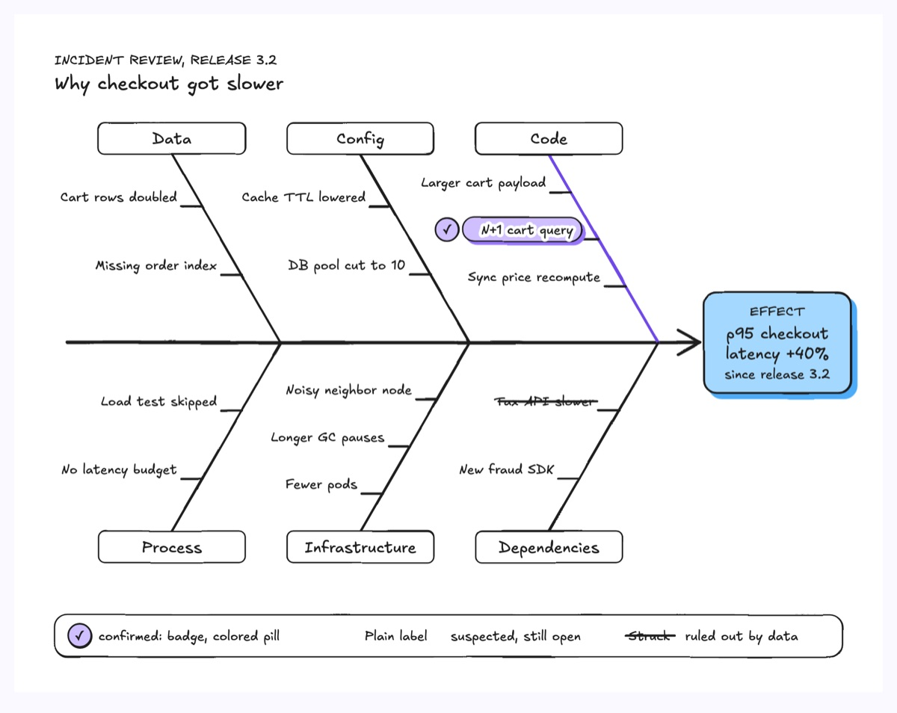
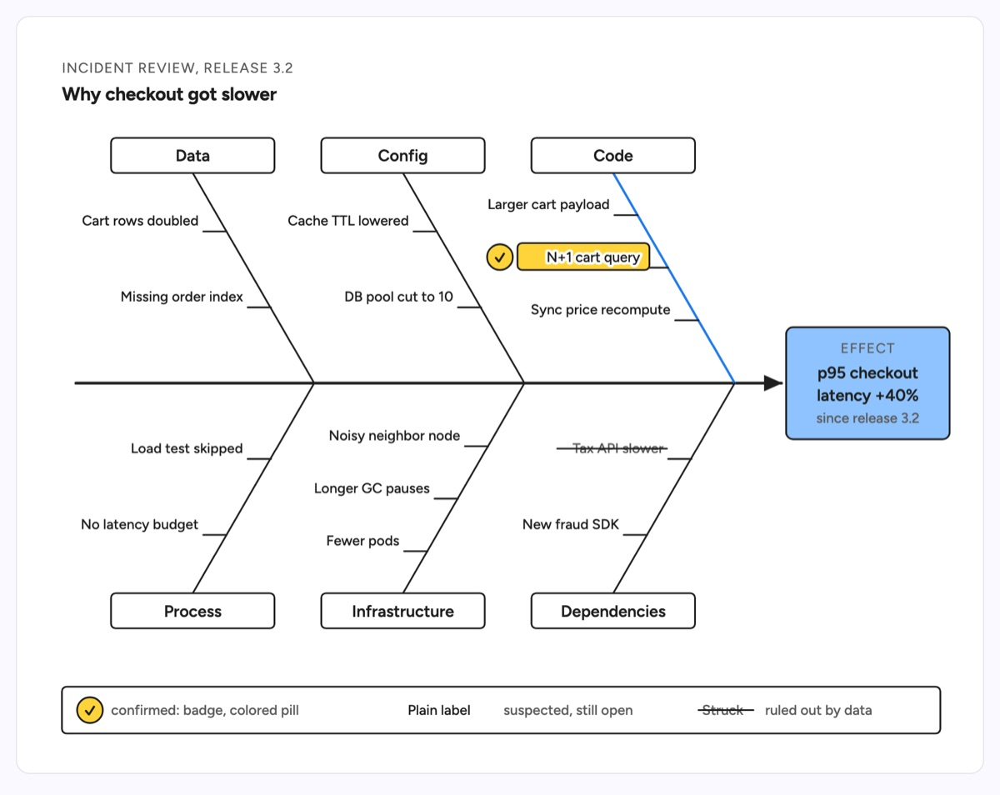

# Fishbone (cause and effect)

A fishbone (Ishikawa) diagram lays out everything an investigation looked at for one observed effect. A horizontal spine runs into the effect box at the head; category ribs leave the spine at one fixed 60 degree angle, alternating above and below, and each rib carries short ticks with the causes found under it. The example is a review of why p95 checkout latency rose 40% after release 3.2: six ribs (Code, Config, Data, Dependencies, Infrastructure, Process) hold two or three causes each, the N+1 cart query on the Code rib is the confirmed root cause, a slower tax API is struck out as ruled out, and the rest stay open as suspects.

| Hand-drawn | Clean |
|---|---|
|  |  |

## Use it to explain

- A postmortem: every cause the team checked for an incident, and which one the evidence confirmed.
- An open investigation into a regression (latency, error rate, cost), so the team can split the remaining suspects.
- Why a flaky test, a failed deploy or a data quality drop happened, grouped by where the causes live.

Not for: feedback loops where effects feed back into causes (use `causal-loop`), or yes/no triage rules (use `decision-tree`).

## Anatomy

| Part | Class | Rule |
|---|---|---|
| Effect | `d-box g4` + `d-k` + `d-t` + `d-s` | the observed symptom with its measure, never the fix |
| Spine | `d-edge thick` with marker | one horizontal line ending in an arrowhead at the effect box |
| Category rib | `d-edge` | straight, all at the same angle, alternating above and below |
| Category name | `d-tag` + `d-t` | at the outer end of the rib, named from the investigation |
| Cause | `d-edge` tick + `d-lab` | short horizontal tick off the rib, label right-aligned past its end |
| Confirmed root cause | `d-edge acc` rib + `d-tag acc` + `d-badge` | the only accented rib and pill, with a check badge |
| Ruled out | `d-s` + `d-edge` strike | muted text with a line through it, still shown as checked |
| Legend | `d-tag` + `d-badge` + `d-s` | confirmed, suspected and ruled out, told by shape and text |

## Tips

- Phrase the effect as what was seen ("p95 checkout latency +40%"), not as the remedy ("add a latency alert").
- Name ribs after where the causes actually came from; never paste a generic 6M template with empty ribs, and delete a rib with no causes.
- Keep to 6 ribs and 3 causes per rib; accent one root cause only. Two confirmed causes means two diagrams or one merged cause.
- A chain of events that happened in order is a timeline or sequence diagram, not a fishbone; causes here are causes of one effect.

Reference: diagram-design Fishbone / Ishikawa (MIT, github.com/cathrynlavery/diagram-design)

Source: [example.svg](example.svg)
