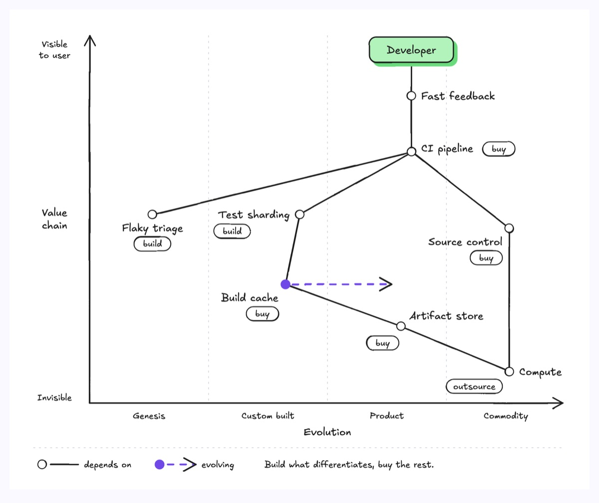
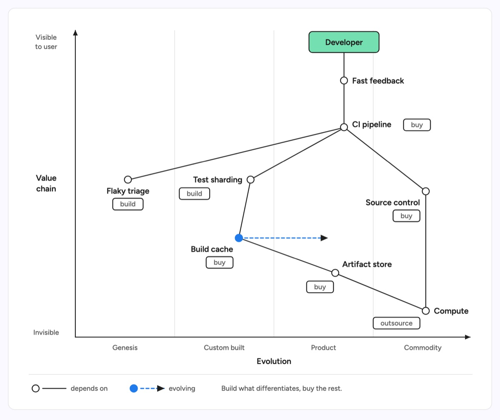

# Wardley map

A value chain plotted against evolution: the user and their need sit at the top, the invisible infrastructure at the bottom, and every component is a small dot placed in one of four evolution stages, Genesis, Custom built, Product and Commodity. Plain lines link a component to the components it depends on, a tag on each says whether to build, buy or outsource it, and a dashed colored arrow shows a component that is moving right. The example maps a team's CI platform, from the developer's need for fast feedback down through the CI pipeline, flaky test triage, test sharding, the build cache, source control and the artifact store to compute, with the homegrown build cache moving toward a bought product.

| Hand-drawn | Clean |
|---|---|
|  |  |

## Use it to explain

- Which parts of a platform to build in house and which to buy or outsource.
- What to commoditise next, so the team stops maintaining code a vendor already sells.
- A strategic move, such as replacing a custom component with a product, and what depends on it.

Not for: prioritising on two factors (use `quad-chart`) or listing the tools a system uses (use `tech-stack-mapping`).

## Anatomy

| Part | Class | Rule |
|---|---|---|
| Value chain axis | `d-axis` + `d-s`, `d-t` | Visible to user at the top, invisible at the bottom, stacked horizontal words, no numbers |
| Evolution axis | `d-axis` + `d-s`, `d-t` | Four named stages along the bottom, never a numeric scale |
| Stage separators | `d-grid` | Three vertical rules splitting the plot into equal stages |
| User anchor | `d-box g1` + `d-t` | The one box on the map, at the top, linked to the user need |
| Component | `d-fillpaper` circle + `d-t` | Dot r 6, label beside it on the side no line leaves from |
| Dependency | `d-edge` | Straight line from a component down to what it depends on, no arrowhead |
| Decision tag | `d-tag` + `d-s` | build, buy or outsource under or beside the label |
| Movement | `d-fillacc` dot + `d-edge acc dash` + marker | The moving component and its arrow are the only accent, pointing right |
| Legend | `d-grid` + samples + `d-s` | Strip below the axes naming line and arrow meanings |

## Tips

- Place each component in a stage, not at a score: evolution is four qualitative bands, so the x axis has no ticks.
- Dependency lines are the one place straight diagonals are right, because a dot's position is the data; pick label sides so no line crosses a label.
- Drop any component with no dependency link, and stop at about 9 components and 12 links.
- Draw at most 2 movement arrows and only to the right; a left arrow or a forecast for everything makes the map unreadable. It is not an architecture diagram, so leave out protocols and request flow.

Reference: diagram-design Wardley Map (MIT, github.com/cathrynlavery/diagram-design)

Source: [example.svg](example.svg)
