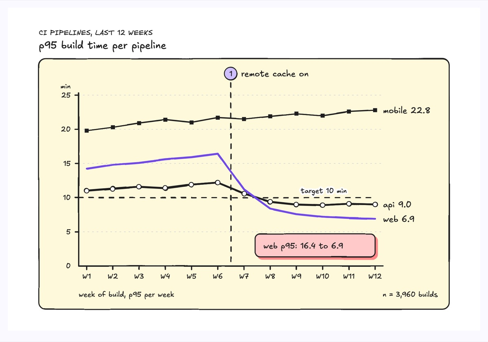
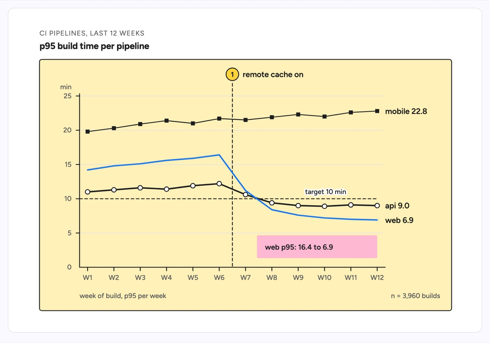

# Line chart

A line chart plots one value per period for a few series, so the reader sees direction, rate of change and the moment something shifted. This example tracks weekly p95 CI build time over 12 weeks for three pipelines against a dashed 10 minute target. A dashed vertical rule with a numbered badge marks week 7, when the remote build cache was turned on: the accented web line drops from 16.4 to 6.9 minutes, api falls from 12.2 to 9.0 and under the target, and mobile, which does not use the cache, keeps creeping up to 22.8. Every line is named at its end, so there is no legend to cross-reference.

| Hand-drawn | Clean |
|---|---|
|  |  |

## Use it to explain

- A trend over time: build time, latency, error rate or cost per week, and whether it is getting better or worse.
- Before and after a change: a rollout, a config flip or a migration marked on the time axis, with the series that moved.
- SLO or budget tracking: each series against a target line, showing when it crossed and whether it stayed there.

Not for: a few categories at one moment (use `bar-graph`) or a two-snapshot comparison of many items (use the slopegraph layout in Tips).

## Anatomy

| Part | Class | Rule |
|---|---|---|
| Chart frame | `d-band g2` | One light panel holding axes, lines and labels |
| Axes, ticks and gridlines | `d-axis`, `d-grid`, `d-s` | Value axis starts at 0 with 4 to 6 round ticks; one tick per period on the time axis; unit above the value axis |
| Series line | `d-edge`, `d-edge thick` | Straight segments between measured points, never smoothed; tell series apart by weight and vertex marker (none, circle, square), not by color |
| Focal series | `d-edge acc thick` | One accented line, the one the story is about |
| Vertex markers | `d-fillpaper` circle, `d-fillink` square | One marker shape per non-focal series, on every measured point |
| End label | `d-t` | Series name and last value just right of the last point, in place of a legend |
| Target line | `d-edge dash` + `d-lab` | Threshold across the whole plot, named where no line passes |
| Change point | `d-edge dash` + `d-badge` + `d-t` | Vertical rule between the two periods, badge and 1 to 3 word label above the plot |
| Finding | `d-note` + `d-tn` | The before and after number for the focal series, in empty space under the lines |

## Tips

- Keep to 5 series at most and 4 to 12 points; aggregate longer runs into weeks or months instead of adding points.
- Label lines at their ends; if two ends crowd, that is because the values are close, so keep the points and nudge only the label text.
- Annotate one change point, not every deploy; more than one rule turns the chart into a timeline.
- For exactly two snapshots of many items (before and after for ten services), use the slopegraph layout: two vertical axes, one straight line per item, name and value printed at both ends, no gridlines.

Reference: diagram-design Line chart (MIT, github.com/cathrynlavery/diagram-design)

Source: [example.svg](example.svg)
