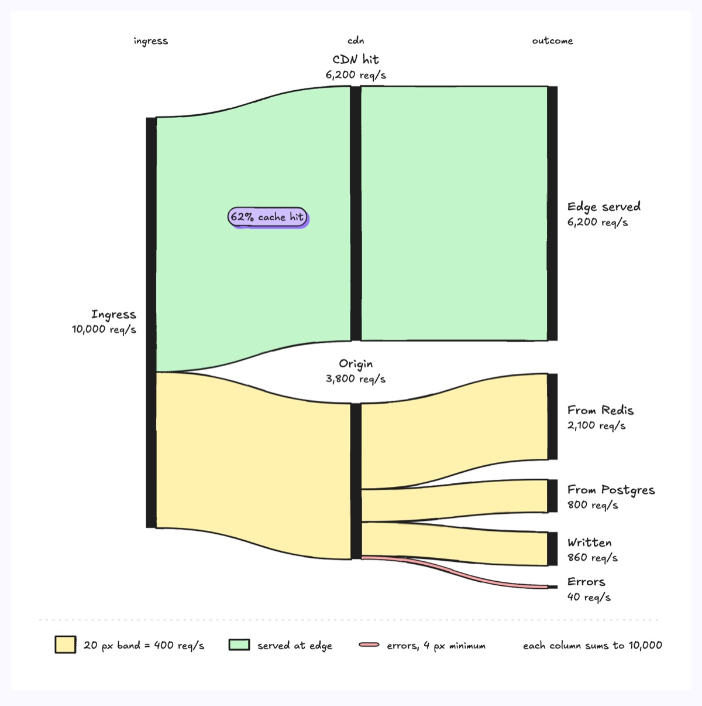
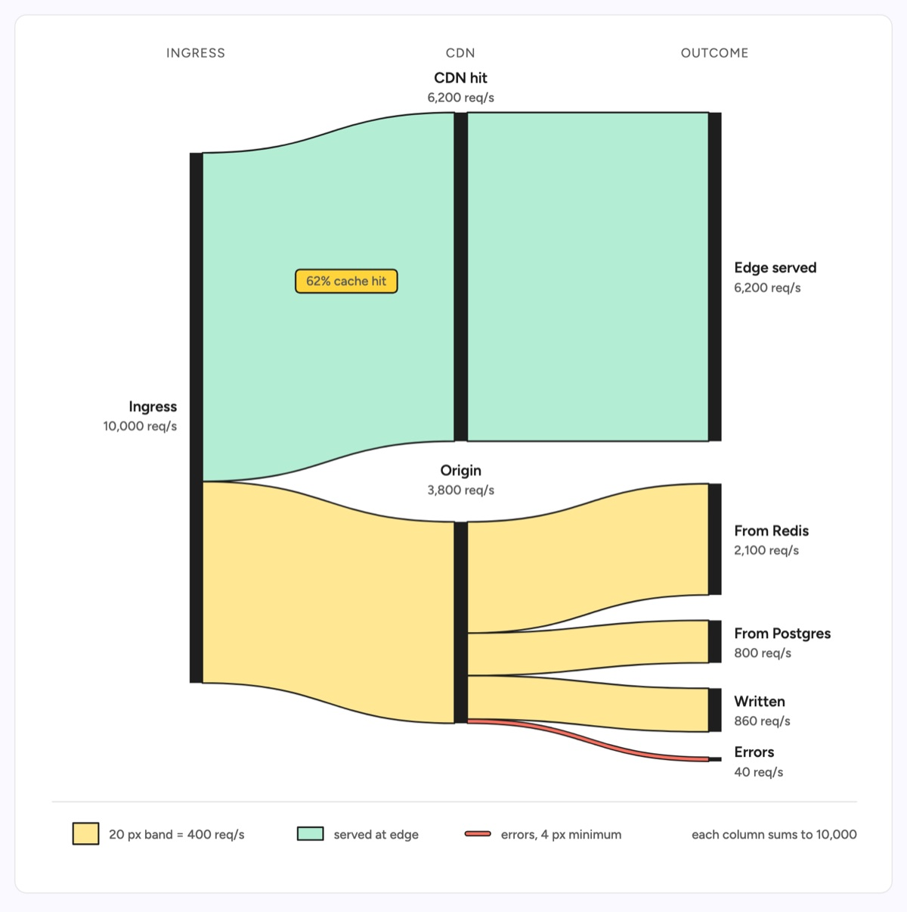

# Sankey diagram

Three stage columns of thin vertical bars joined by filled bands whose width is proportional to the quantity flowing between them, so splits and merges read as magnitudes rather than just links. The example follows 10,000 API requests per second: 6,200 are CDN cache hits served at the edge and 3,800 reach the origin, where they split into 2,100 served from Redis, 800 from Postgres, 860 writes and 40 errors. One scale holds for every band (1 px = 20 req/s), each column sums to 10,000, and the errors band is the one solid ribbon, widened to a visible 4 px.

| Hand-drawn | Clean |
|---|---|
|  |  |

## Use it to explain

- Where traffic goes: how much the cache absorbs and what share of requests each backing store or failure path takes.
- Where cost or compute is spent as a budget splits across services, stages and outcomes.
- How tokens or events divide and recombine across a pipeline, such as prompt, cache and completion tokens per model.

Not for: a single quantity dropping off stage by stage with no splits (use `marketing-funnel`) or the mechanics of each processing step (use `data-pipeline`).

## Anatomy

| Part | Class | Rule |
|---|---|---|
| Stage header | `d-k` | Exactly 3 columns, one short kicker centred over each |
| Node | `d-fillink` rect | 12 px wide bar, height = quantity times one scale for the whole drawing |
| Node label | `d-t` + `d-s` | Name, then the value; left of column 1, in the gutter above a column 2 bar, right of column 3 |
| Band | `d-soft g1`..`g2` | One closed path; top and bottom edges are cubics with both control points at the midpoint x so the band meets each bar flat |
| Exception band | `d-fill g3` | The failure path in a solid colour, drawn at 4 px minimum and said so in the legend |
| Callout | `d-tag acc` | One editorial read, placed on the band it describes |
| Legend | swatches + `d-s` | The scale as a sample band, the colour meaning, and the column total |

## Tips

- Pick one px per unit for every column and check that each column sums to the same total; a Sankey that does not balance reads as a bug.
- Stack bands on a node in the same top to bottom order as their targets so no two ribbons cross; reorder nodes before accepting a tangle.
- Colour by meaning (served at edge, origin, error), never one hue per band; fold flows thinner than 4 px into "other" unless, like errors, they are the point.
- Keep to 3 stages, 8 nodes and 12 bands; beyond that split into two linked Sankeys. A single narrowing quantity is a funnel, and a chain with no splits is a process diagram.

Reference: diagram-design Sankey (MIT, github.com/cathrynlavery/diagram-design)

Source: [example.svg](example.svg)
