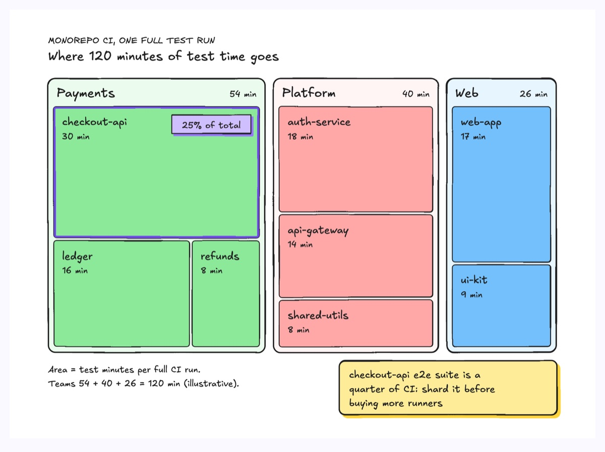
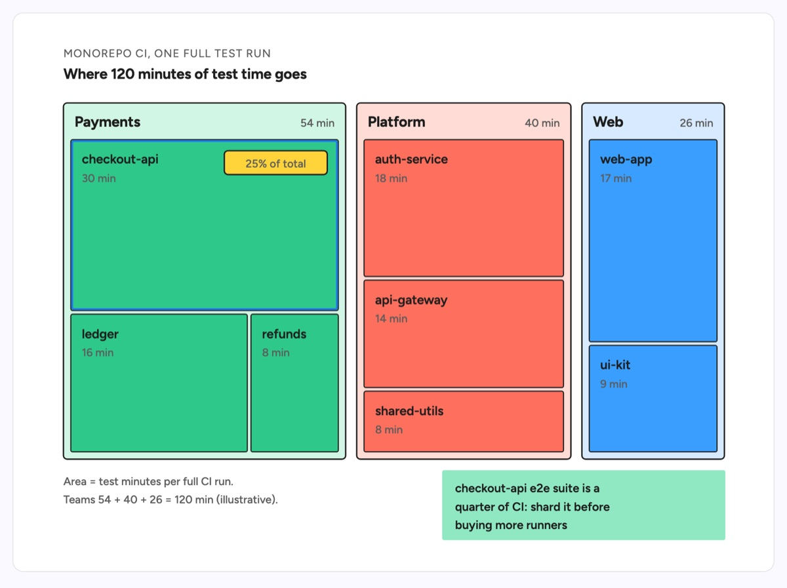

# Treemap

A treemap splits one total into nested rectangles whose area is each part's share. This example is where 120 minutes of test time goes in one full CI run of a monorepo: three team regions (Payments 54 min, Platform 40 min, Web 26 min) each tile their packages, from checkout-api at 30 minutes down to refunds and shared-utils at 8. Every rectangle is drawn to within about 1% of its true area, the single biggest package carries the accent outline and a "25% of total" tag, a source line states the encoding and the sum, and a sticky note names the action.

| Hand-drawn | Clean |
|---|---|
|  |  |

## Use it to explain

- Where CI test time, build time or flaky retries go, by team and package.
- How a cloud or vendor bill splits by team and then by service.
- What dominates a JavaScript bundle, grouped by dependency and module.

Not for: five or fewer parts with no hierarchy (use `pie-chart`) or showing how files are laid out on disk (use `directory-tree`).

## Anatomy

| Part | Class | Rule |
|---|---|---|
| Group region | `d-band g0`..`g5` | One per team, header row holds name (`d-h`) and subtotal (`d-s`) |
| Cell | `rect.d-fill` in the group's `gN` | Area proportional to the value, 4px gutter, squarified so aspect ratios stay near 1 |
| Cell label | `d-t` + `d-s` | Name, then value, top-left 12px in |
| Focal cell | `d-edge acc` outline + `d-tag acc` | One cell only, with its share of the whole |
| Encoding line | `d-s` | States what area means and that the groups sum to the total |
| Finding | `d-note` + `d-tn` | What the dominant cell means and the action to take |

## Tips

- Area is the only encoding: never pad, floor or shrink a cell to fit its label, and check each drawn area against its value as relative error (keep within 5%).
- Keep to about 8 cells and two levels; merge the tail into a named "Other" cell rather than drawing unlabelable slivers.
- Lay cells out squarified, largest first; long thin stripes defeat the area comparison.
- One fill hue per group and one accent cell; a rainbow of per-cell colors hides both the grouping and the rank.

Reference: diagram-design Treemap (MIT, github.com/cathrynlavery/diagram-design)

Source: [example.svg](example.svg)
