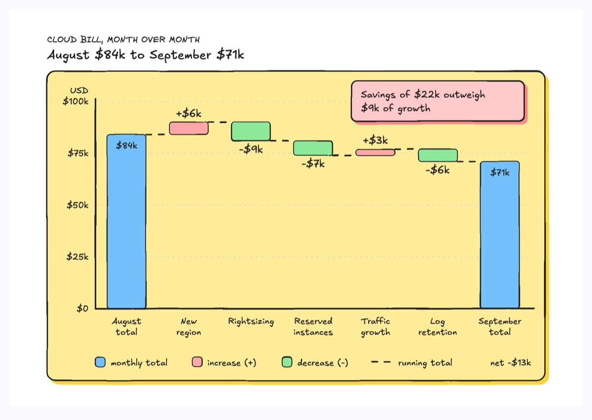
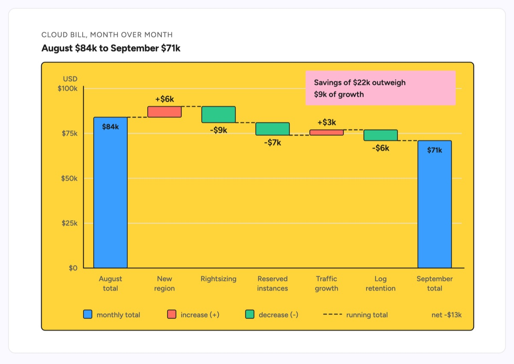

# Waterfall chart

A waterfall chart walks a start total to an end total through signed steps: the two totals stand on the baseline, and each step floats between the running total before and after it, with a dashed carry line holding that level across every gap. This example is a monthly cloud bill bridge from $84k in August to $71k in September: a new region adds $6k, rightsizing removes $9k, reserved instances remove $7k, traffic growth adds $3k and a log retention cut removes $6k (84 + 6 - 9 - 7 + 3 - 6 = 71). Increases and decreases take different fills and also print their sign, and a sticky note states the takeaway: $22k of savings outweigh $9k of growth.

| Hand-drawn | Clean |
|---|---|
|  |  |

## Use it to explain

- A budget or cost bridge: why this month's cloud, vendor or infra bill differs from last month's.
- A latency budget walk: how a p95 moved from one release to the next, step by contributing change.
- A headcount or capacity bridge: starting roster plus hires minus attrition and transfers.

Not for: independent values with no running total (use `bar-graph`) or shares of one total (use `pie-chart` or `treemap`).

## Anatomy

| Part | Class | Rule |
|---|---|---|
| Chart frame | `d-box g2` | One panel holding axes, bars, legend and note |
| Axes and gridlines | `d-axis`, `d-grid` | Value axis starts at 0 with round $ ticks in `d-s`; never truncate it |
| Total bar | `d-fill g4` + `d-tw` | Start and end totals stand on the baseline, value printed inside, unsigned |
| Step bar | `d-fill g3` (increase), `d-fill g1` (decrease) | Spans exactly the running totals before and after; equal width and pitch |
| Step value | `d-t` | Signed (`+$6k`, `-$9k`): above an increase, below a decrease |
| Carry line | `d-edge dash` | Horizontal at the running total, from one bar's edge to the next bar's edge |
| Category label | `d-s` | Short driver name under each bar, two lines at most |
| Legend and net | `d-fill` swatch + `d-s` | One row: total, increase, decrease, carry sample and the net change |
| Finding | `d-note` + `d-tn` | The one sentence the walk proves |

## Tips

- Check the arithmetic before drawing: start plus every signed step must equal the end total exactly, and every bar must sit on one shared scale.
- Never leave a floating bar without its carry line; without it the chart is just bars at odd heights.
- Do not encode sign by color alone: print `+` or `-` on every step so it survives greyscale and the hand style.
- Keep it to 8 bars including totals and at most one subtotal; merge small drivers into a named "Other" step or split the walk in two.

Reference: diagram-design Waterfall Chart (MIT, github.com/cathrynlavery/diagram-design)

Source: [example.svg](example.svg)
