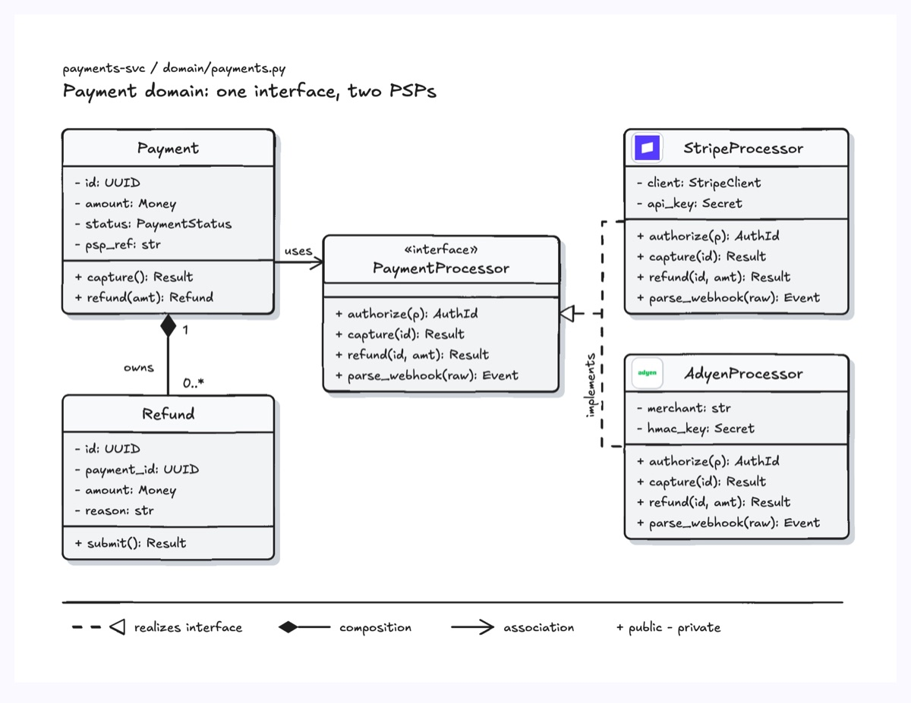
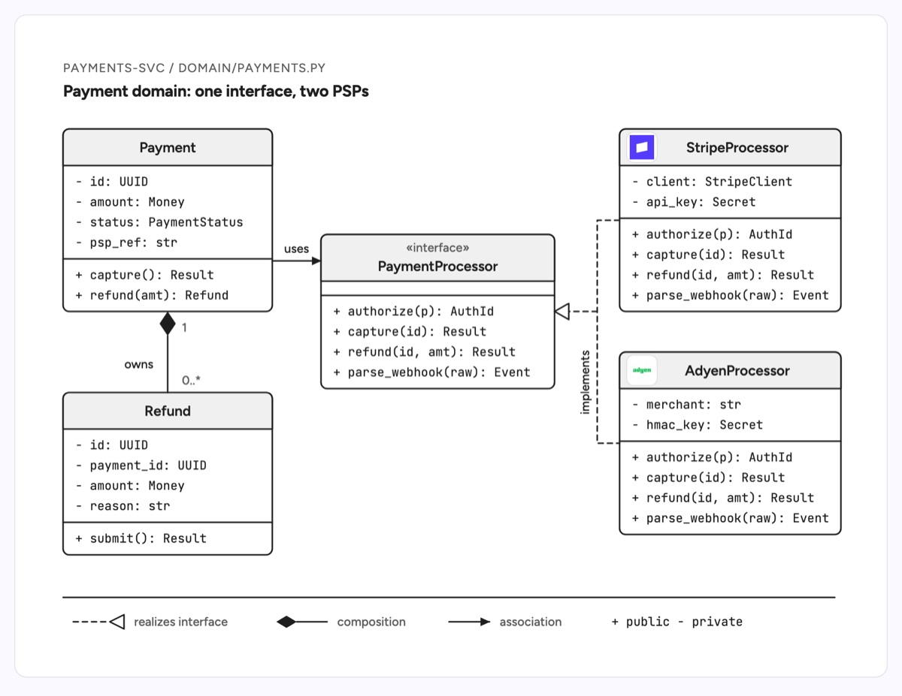

# Class diagram

A UML class diagram shows the types in a codebase, what each one holds and exposes, and how they relate: inheritance, interface realization, composition and plain association. This example is the payment domain of a payments service: `StripeProcessor` and `AdyenProcessor` both implement the `PaymentProcessor` interface, `Payment` calls through that interface, and each `Payment` owns zero or more `Refund` objects.

| Hand-drawn | Clean |
|---|---|
|  |  |

## Use it to explain

- A plugin or adapter seam, such as one interface with a provider class per vendor (payments, storage, LLM clients).
- Which objects own the lifecycle of others (composition) versus merely calling them (association).
- The public surface of a module before a refactor: fields stay private, methods are the contract.

Not for: runtime call order (use `sequence-diagram`) or database tables (use `er-diagram`).

## Anatomy

| Part | Class | Rule |
|---|---|---|
| Class | `d-box` + `d-band` header | White box, thin ink outline; the name sits in a light grey `d-band` header (no g-colour), then fields and methods split by a `d-line` |
| Interface | `d-box` + `d-band` + `d-s` stereotype | `«interface»` above the name inside the header band; the field compartment stays empty |
| Member | `d-m` | Mono, prefixed `+` public or `-` private, `name: Type` |
| Vendor logo | `d-logo` | In the header of a class that wraps a real product |
| Realization | `d-edge dash` + hollow `d-fillpaper` triangle | Forked lines merge into one triangle at the interface |
| Composition | `d-fillink` diamond + `d-edge` | Filled diamond on the owner, multiplicities as `d-s` |
| Association | `d-edge` + marker + `d-lab` | Arrow with a verb label ("uses") |
| Colour | none, or one `g` colour | Structure diagrams stay neutral; if colour carries one meaning (such as new or changed members), use one colour for it and add it to the legend |

## Tips

- Group implementations on one side and merge their realization lines into a single fork, as in the template.
- Show only the members that explain the design; three or four per compartment.
- A class that realizes an interface lists every interface method, so a missing one reads as a bug, not a shortcut.
- Put multiplicities (`1`, `0..*`) at both ends of a composition so ownership is unambiguous.
- Keep at least 32 units of clear margin inside the viewBox on every side; this example widens the viewBox to `-12 -12 830 624` around content drawn from x=20.

Reference: Figma template Class diagram

Source: [example.svg](example.svg)
