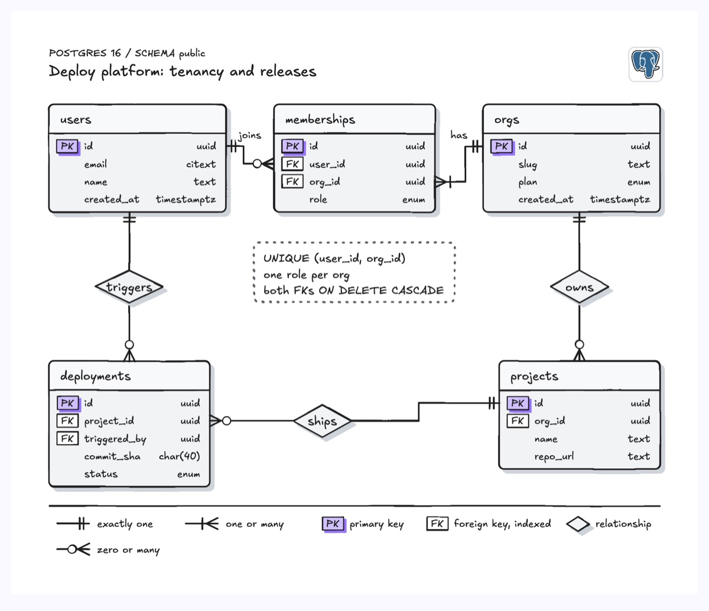

# Entity relationship diagram

An entity relationship diagram shows the tables in a database, the columns that identify them, and how rows in one table relate to rows in another. This example is the core Postgres schema of a deploy platform: users join orgs through a `memberships` table, orgs own projects, and projects ship deployments that a user triggers. Each table is a box with PK and FK tags, relationships are named diamonds in the middle of the line, and crow's foot ends say "exactly one", "one or many" or "zero or many".

| Hand-drawn | Clean |
|---|---|
|  |  |

## Use it to explain

- The tables behind a service and which foreign keys tie them together, before a migration review.
- Multi-tenant ownership: which table carries the tenant key and how a join table resolves many-to-many.
- Cascade and uniqueness rules that a reviewer needs to see next to the columns they constrain.

Not for: query plans or data flow between services (use `data-pipeline` or `sequence-diagram`).

## Anatomy

| Part | Class | Rule |
|---|---|---|
| Table | `d-box` + `d-band` header | White box, thin ink outline; the name (`d-t`) sits in a light grey `d-band` header with no g-colour, then one row per column, 22 units tall |
| Column | `d-m` + `d-s` | Field name in mono on the left, type right-aligned and muted |
| Key tag | `d-tag acc` / `d-tag` + `d-k` | `PK` filled, `FK` outlined; only on key columns. The filled PK tag is the only colour in the diagram, and the legend explains it |
| Relationship | `d-box` diamond + `d-t` | White diamond with a verb ("owns", "ships") on long edges; short edges use a `d-lab` |
| Cardinality | `d-edge` | Two bars for exactly one, crow's foot plus bar for one or many, crow's foot plus circle for zero or many (a parent row that may have no children yet), drawn at the table edge |
| Constraint note | `d-blob2` + `d-tn` | Uniqueness or cascade rules in a dashed neutral box, placed in empty space near the table |
| Legend | `d-s` | Explain notation once, below a rule line |
| Colour | at most one meaning | Structure diagrams stay neutral; spend one colour on one meaning (here the primary key; on a change review, new or changed columns) and put it in the legend |

## Tips

- Anchor each edge on the row of the key column it joins, not the box center, so the reader can follow the FK.
- Keep only the columns that matter to the story; four or five per table is plenty.
- Name relationships with a verb read from the "one" side to the "many" side.
- Add the engine logo (`postgresql.org`) so the dialect is obvious.
- Keep at least 32 units of clear margin inside the viewBox on every side; this example widens the viewBox to `-12 -12 824 698` around content drawn from x=20.

Reference: Figma template Entity relationship diagram

Source: [example.svg](example.svg)
