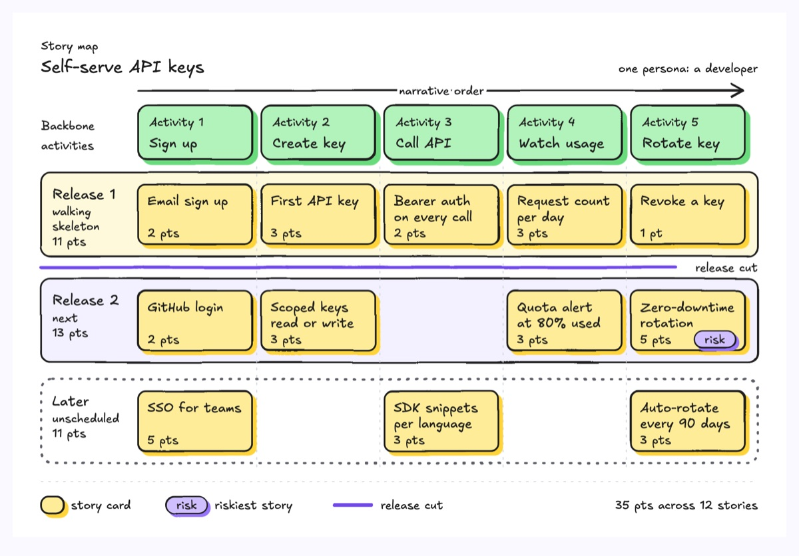
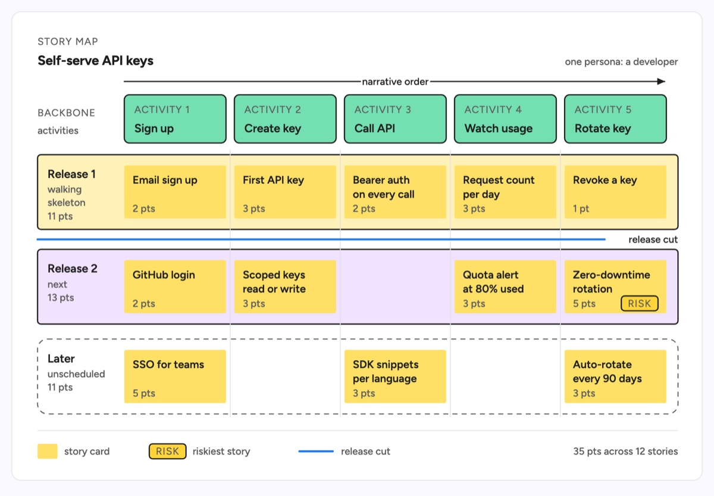

# Story map

A user story map: a backbone of user activities across the top in the order the user meets them, the stories for each activity stacked in its column underneath, and horizontal release slices that cut the stack into what ships first and what waits. A thick colored release cut line sits under the first slice, and one card carries a risk tag. The example is a self-serve API key feature for a developer platform: sign up, create key, call API, watch usage and rotate key, sliced into a Release 1 walking skeleton (one story per activity, 11 pts), Release 2 (13 pts) and Later (11 pts), with zero-downtime rotation flagged as the riskiest story.

| Hand-drawn | Clean |
|---|---|
|  |  |

## Use it to explain

- How a feature is scoped into releases, and which thin end-to-end slice ships first.
- What was cut from the first release and why the cut sits where it does.
- Where the gaps and the riskiest story are across the whole user flow before planning sprints.

Not for: dates and dependencies between tasks (use `gantt-chart`) or a flat checklist of work (use `todo-list`).

## Anatomy

| Part | Class | Rule |
|---|---|---|
| Narrative arrow | `d-edge` + `d-lab` | One arrow over the backbone, left to right, labelled with the reading order |
| Backbone | `d-box g1` + `d-k`, `d-t` | Up to 5 activities in the order the user does them, same width as the cards below |
| Slice | `d-band` (`g2`, `g0`), `d-blob2` for Later | Full-width rows, one per release; label, outcome and points in the left margin |
| Column rule | `d-grid` | Dashed separators between columns so gaps read as gaps, not scatter |
| Story card | `d-note` + `d-tn`, `d-s` | A user-visible outcome in two short lines, estimate below |
| Release cut | `d-edge acc thick` + `d-lab` | Under the first slice, label at its right end; one of the two accents |
| Risk flag | `d-tag acc` + `d-k` | On the single riskiest card; the second accent |
| Legend | `d-grid`, `d-s` | Story card, risk tag and cut line samples, total points on the right |

## Tips

- The release cut is the point of the drawing; a map without one is a backlog in a grid.
- Order columns by the user's narrative, not by priority, and name slices by outcome (walking skeleton, next, later), never by quarter.
- Write stories as outcomes a user sees ("Revoke a key"), not internal work ("Refactor auth service"), and keep one persona per map.
- Stay within 5 activities, 3 slices and 12 cards; past that, split into one map per activity or collapse Later into a count.

Reference: diagram-design User Story Map (MIT, github.com/cathrynlavery/diagram-design)

Source: [example.svg](example.svg)
