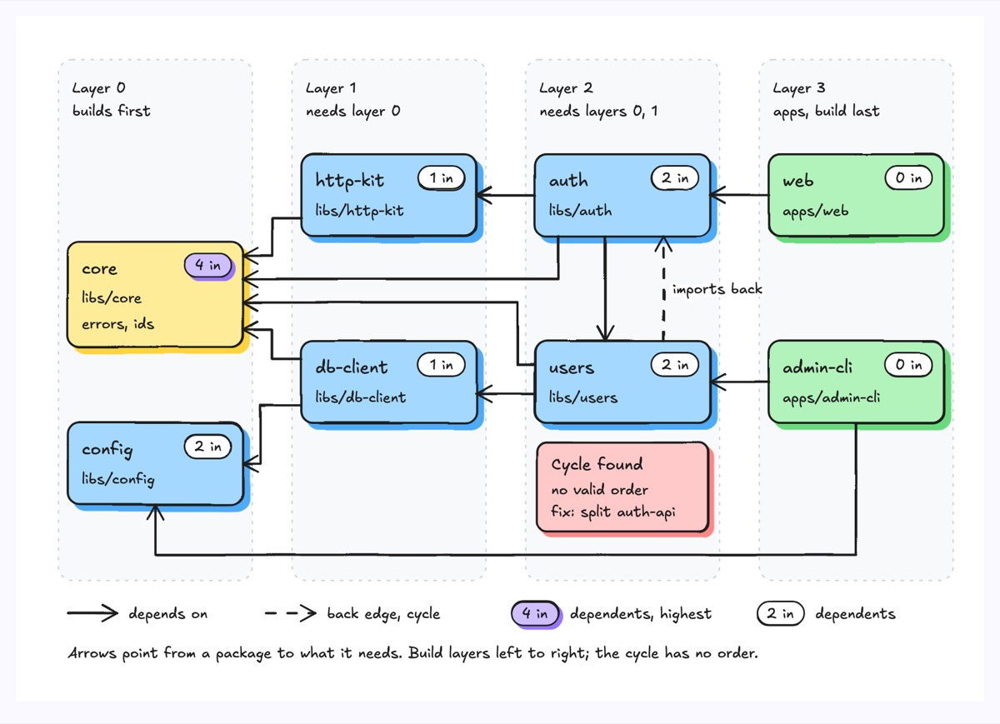
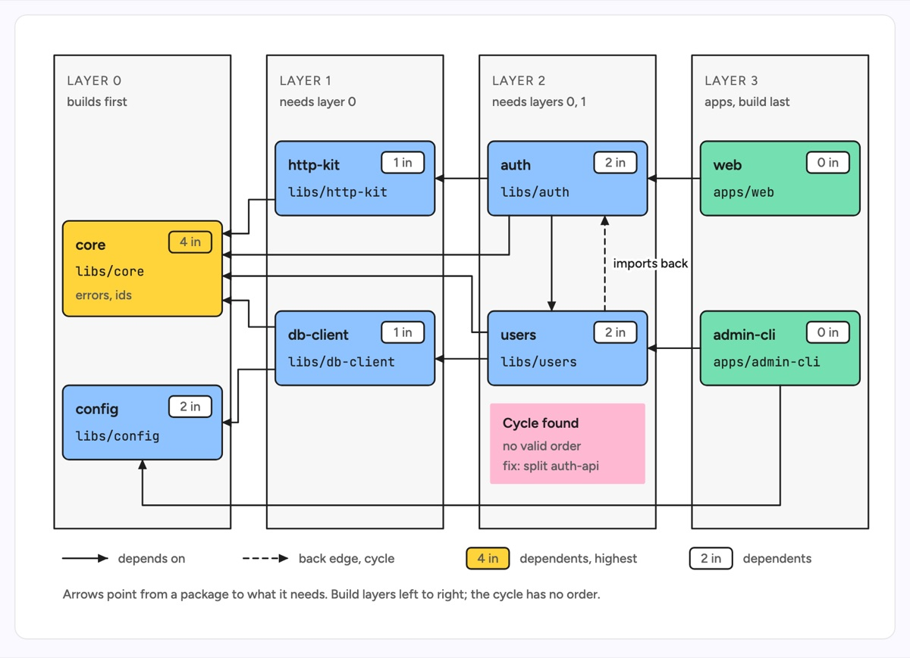

# Dependency graph

Packages laid out in columns by build order, layer 0 on the left (needs nothing) and apps on the right (built last), with every arrow pointing from a package to the package it depends on. Each box carries a fan-in pill counting how many packages depend on it, so the shared library everyone leans on stands out. The example is a monorepo: `core` and `config` in layer 0, `http-kit` and `db-client` in layer 1, `auth` and `users` in layer 2, and the `web` and `admin-cli` apps in layer 3. `core` has the highest fan-in (4 in) and is highlighted; `users` imports back into `auth`, a cycle drawn as a dashed edge and flagged with a red note.

| Hand-drawn | Clean |
|---|---|
|  |  |

## Use it to explain

- The build order of a monorepo or workspace: what must compile first and which packages can build in parallel within a layer.
- The blast radius of a change: follow arrows backwards from a package to see everything that rebuilds or retests when it changes.
- A cycle that blocks a clean build order or a package split, and where to cut it.

Not for: strict hierarchies where every node has one parent (use `functional-decomposition`) or data moving between systems (use `data-pipeline`).

## Anatomy

| Part | Class | Rule |
|---|---|---|
| Build layer | `d-lane alt` + `d-k`, `d-s` | One column per layer, left to right in build order, kicker "Layer N" and what it needs |
| Package | `d-box g4` + `d-t`, `d-m` | One box per package or module, never per file; name in `d-t`, path in `d-m` |
| App (leaf) | `d-box g1` | Nothing depends on it; always in the rightmost layer |
| Shared core | `d-box g2` + `d-tag acc` | The single highest fan-in node; the only accent in the drawing |
| Fan-in pill | `d-tag` + `d-s` | Top-right of every box, "N in" = number of incoming arrows |
| Depends on | `d-edge` | From dependent to dependency, orthogonal elbows in the gaps between layers, one attach point per arrow |
| Cycle | `d-edge dash` + `d-lab`, `d-note g1` | The one back edge, labelled with its verb, with a red note saying why it hurts and how to break it |
| Legend | `d-edge`, `d-edge dash`, `d-tag` | Sample of each edge style and pill under the layers |

## Tips

- Rank first: put each package in the layer one past its deepest dependency. A graph with no layers turns into a hairball.
- If every node has exactly one parent and nothing points back, the data is a tree; draw a `functional-decomposition` or `directory-tree` instead.
- Highlight one cycle at most; a second one competes with the first and neither reads. Do not recolor the two nodes in the cycle, the dashed edge and note carry it.
- Keep to about 9 nodes and 14 edges; past that, collapse a cluster of leaves into one box such as "+6 leaf packages" and say so in the caption. Route long edges through the free row between boxes, never behind a box.

Reference: diagram-design Dependency Graph (MIT, github.com/cathrynlavery/diagram-design)

Source: [example.svg](example.svg)
