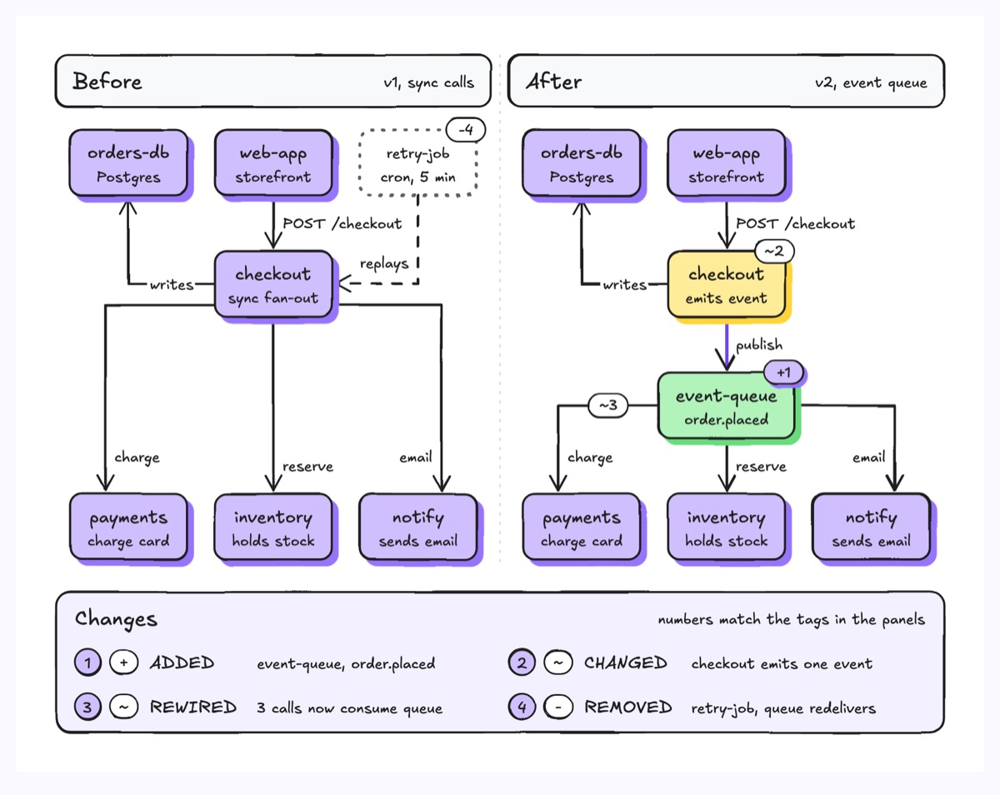
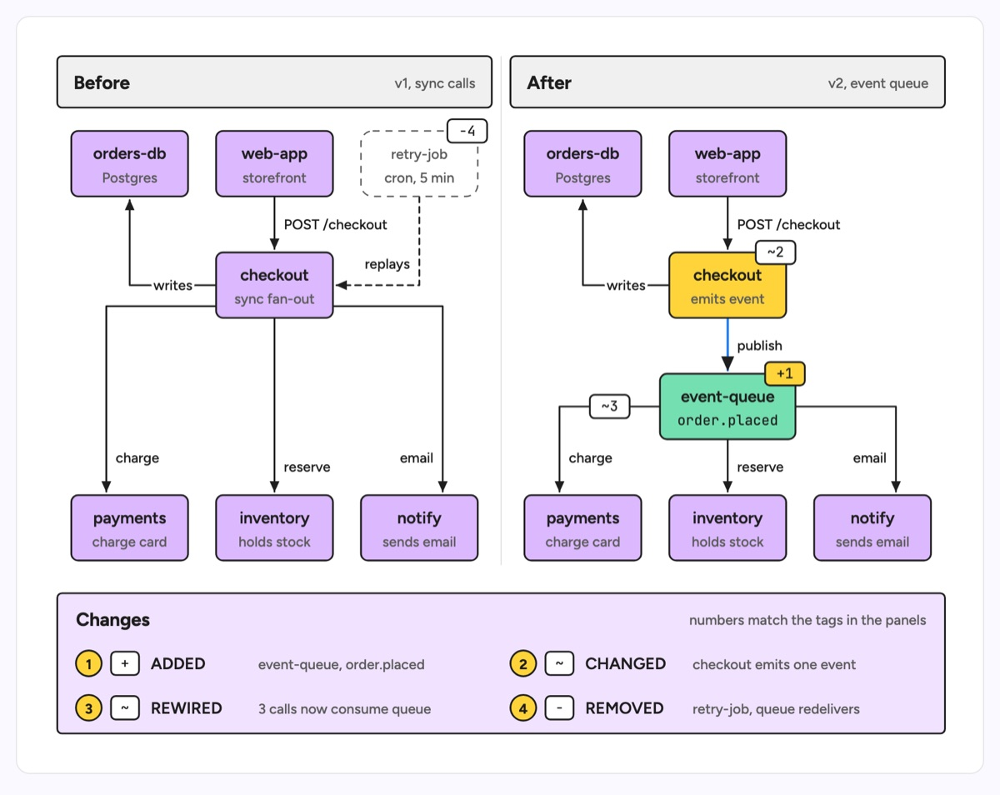

# Architecture delta

Two synchronized topology panels, Before on the left and After on the right, drawn on the same grid so every unchanged component sits at the same spot in both and the eye lands only on what moved. Added parts are filled and tagged `+`, removed parts are dashed and greyed with a `-` tag, changed parts carry a `~` tag, and a Changes ledger along the bottom lists each numbered change in one line. The example is a checkout service moving from synchronous calls to an event queue: checkout now publishes `order.placed` to a new event-queue, the charge, reserve and email calls are rewired to consume from that queue, and the retry-job that replayed failed calls is removed because the queue redelivers.

| Hand-drawn | Clean |
|---|---|
|  |  |

## Use it to explain

- A migration in a design review: what a refactor adds, removes and rewires, with everything else held still.
- A service extraction or a new async hop, so reviewers see which callers change and which do not.
- The "what changed" section of an ADR or a release note for platform teams.

Use this over `c4-model` when the story is the difference between two states, not the structure of one; use `tech-stack-mapping` when the change is a product swap per layer rather than a change in who talks to whom.

Not for: attribute-only changes such as version bumps or config values (use a table), or a single snapshot of the system (use `c4-model` or `layered-architecture`).

## Anatomy

| Part | Class | Rule |
|---|---|---|
| Panel header | `d-band` + `d-h`, `d-s` | "Before" and "After" with a version or date on the right; both panels the same size |
| Panel divider | `d-grid` | One vertical rule between the panels |
| Unchanged component | `d-box g0` + `d-t`, `d-s` | Identical position, size and label in both panels; no tag, no ledger entry |
| Added component | `d-box g1` + `d-tag acc` | Only in After, filled, tagged `+N` |
| Changed component | `d-box g2` + `d-tag` | Same spot in both panels, subtitle states the new behaviour, tagged `~N` in After |
| Removed component | `d-blob2` + `d-s` | Only in Before, dashed and muted, tagged `-N`; its edges are `d-edge dash` |
| Relationship | `d-edge` (+ `acc` for the added path) + `d-lab` | Orthogonal, verb label; a rewired edge keeps its verb and is tagged `~N` on the wire |
| Changes ledger | `d-band g0` + `d-badge`, `d-tag`, `d-t`, `d-s` | One row per numbered change: badge, symbol, change word, what actually differs |

## Tips

- Copy the Before coordinates into After first, then edit. Two independently laid out panels invent movement that did not happen.
- Every tag needs a ledger row and every ledger row needs a tag; write the real difference ("checkout emits one event"), never just "updated".
- Status reads from shape and symbol, not only colour: dashed for removed, filled plus `+` for added, `~` for changed. Keep the accent for the one new path.
- Stay within about 8 unique components, 10 relationships and 8 ledger rows; split a bigger migration into subsystems rather than dropping edges. A delta shows two states, not the rollout order, so pair it with a timeline if sequencing matters.

Reference: diagram-design Architecture delta (MIT, github.com/cathrynlavery/diagram-design)

Source: [example.svg](example.svg)
