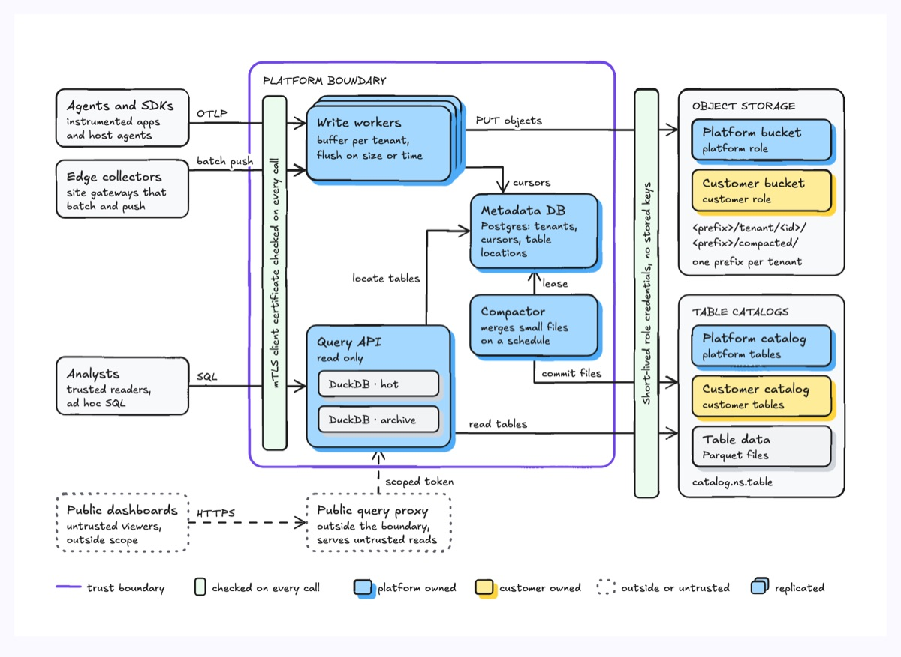
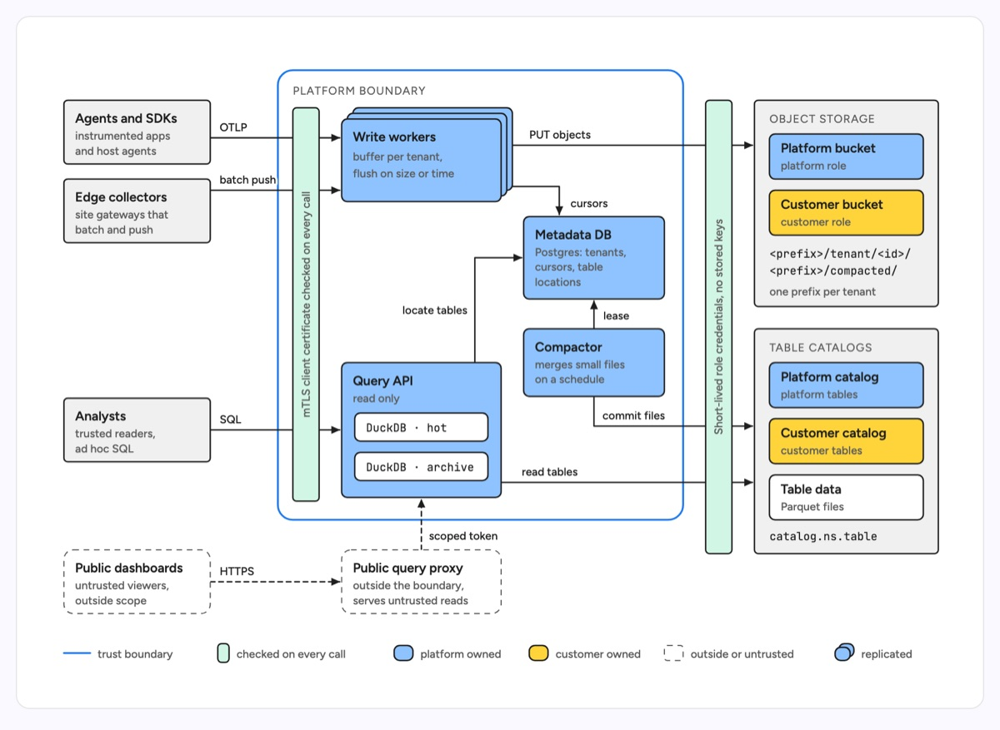

# Boundary architecture

One system drawn as a single rounded boundary, with the callers on the left, the stores it writes to on the right, and two checkpoint bars between them: a gate just inside the left edge that every inbound call crosses, and a credential bar outside the right edge that every outbound write crosses. The diagram answers what crosses the trust boundary, what is checked at the edge, and where data lands. The example is a metrics ingestion platform: agents and SDKs send OTLP, edge collectors batch push and analysts run SQL through an mTLS gate; inside, replicated write workers buffer per tenant and PUT objects, a Postgres metadata DB holds tenants, cursors and table locations, a compactor merges small files under a lease, and a read only query API runs two DuckDB engines; short-lived role credentials reach object storage and table catalogs that belong either to the platform or to the customer; untrusted public dashboards go through a query proxy that lives outside the boundary and holds only a scoped token.

| Hand-drawn | Clean |
|---|---|
|  |  |

## Use it to explain

- A security or design review: which callers are trusted, which are not, and the one check every inbound call passes.
- Data residency and ownership: which bucket or catalog the platform owns, which the customer owns, and how the platform gets credentials to each.
- Why a component sits outside the system (a public proxy, a partner gateway) and what narrow credential links it back in.

Use this over `cloud-architecture` when trust and ownership matter more than the cloud services the system runs on; use `system-context` when the reader only needs the system and its neighbours, with no internals or checks.

Not for: the order of calls in one request (use `sequence-diagram`), the internal layers of one service (use `layered-architecture`), or what a change adds and removes (use `architecture-delta`).

## Anatomy

| Part | Class | Rule |
|---|---|---|
| External actor | `d-band` + `d-t`, `d-s` | Left column, one box per caller kind: bold name, one or two muted lines saying who they are |
| Untrusted or out of scope actor | `d-blob2` + `d-t`, `d-s` | Dashed, no fill; its edges are `d-edge dash` |
| System boundary | `rect.d-edge acc` + `d-k` | One rounded outline around everything the system runs; uppercase mono label in the top-left corner. This is one of the two accent elements |
| Edge gate | `d-band g1` + rotated `d-s` | Tall narrow bar just inside the left edge, text rotated with `transform="rotate(-90 cx cy)"` naming what is checked; every inbound edge crosses it |
| Component | `d-box g4` + `d-t`, `d-s` | One tint for everything the system runs; bold title, short description |
| Replicated component | 3 stacked `d-box g4` | Back cards offset 6 and 12 up and right; draw back to front, start outgoing edges at the back card's edge |
| Nested engine or module | `d-box` + `d-m` | Small neutral sub-boxes inside a component, mono name |
| Outbound credential bar | `d-band g1` + rotated `d-s` | Outside the right edge of the boundary; every edge to a store crosses it |
| Store group | `d-band` + `d-k`, `d-m`, `d-s` | Uppercase mono header, sub-boxes, mono path lines, one short caption |
| Ownership variant | `d-box g4` / `d-box g2` | Platform owned in the component tint, customer owned in a second tint, both named in the legend |
| Outside component | `d-blob2` + `d-t`, `d-s` | Dashed, below or beside the boundary, linked by a `d-edge dash` naming its credential |
| Connector | `d-edge` + `d-lab` | Orthogonal, arrowhead on the receiving end, label names the protocol or verb (OTLP, PUT objects, lease) |
| Legend | `d-edge acc`, `d-band g1`, `d-box`, `d-blob2` + `d-s` | One row under the drawing: boundary line, checkpoint bar, each tint, dashed and stacked cards |

## Tips

- Adapt it by renaming the two bars first: write the gate as the literal check ("JWT audience checked", "VPN plus SSO") and the right bar as how the system authenticates outward. If nothing is checked on a side, drop that bar rather than leave it vague.
- Keep the columns on a grid: actors, gate, two component columns, credential bar, store groups. Line inbound edges up with the box they enter so they stay straight.
- Ownership reads from the tint and the word: label sub-boxes "Platform ..." and "Customer ..." so the meaning survives without colour.
- Stay within about 5 actors, 6 components, 2 store groups and 12 connectors. A larger system gets an overview boundary and a detail figure per zone.
- The accent goes on the boundary and at most one more element (the path under review); everything else stays ink.

Source: [example.svg](example.svg)
