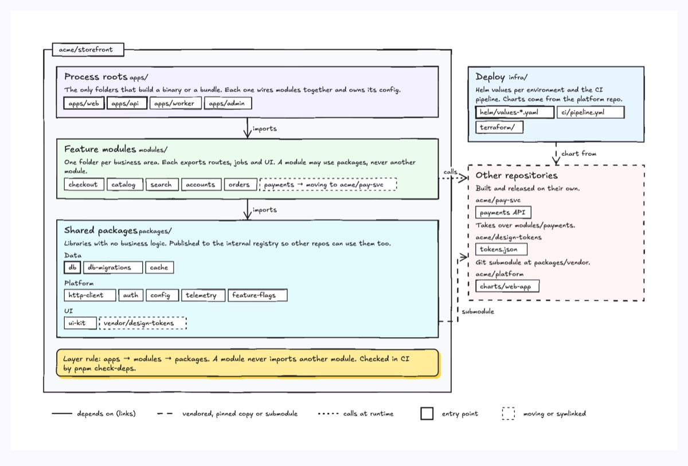
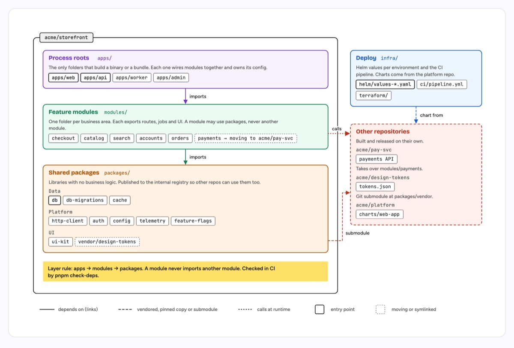

# Repo map

One repository drawn as nested containers: an outer frame with the repo name on a tab, one tinted container per top-level folder or layer (title, path in mono, one or two lines on what it holds), and mono chips inside for the crates, packages or modules. Other repositories sit beside it, runtime services under it. Three line styles carry three meanings: solid for "depends on" (a build link), dashed for a vendored, pinned or submodule copy, dotted for a call at runtime. A bold chip is the entry point of its group, a dashed chip is moving or symlinked. A sticky note states the layer rule and what enforces it. The example is `acme/storefront`: apps import modules, modules import packages, payments is moving out to `acme/pay-svc`, and the design tokens come in as a git submodule.

| Hand-drawn | Clean |
|---|---|
|  |  |

## Use it to explain

- How a repository is cut up and which way dependencies are allowed to point, for onboarding or a review.
- A monorepo with extracted services: what still lives here, what moved out, and how the two talk.
- The "parts and boundaries" section of an engineering page, before the request path.

Use this over `directory-tree` when the story is dependencies and layers, not just folder names; use `dependency-graph` when there are few parts and the edges are the story; use `layered-architecture` for a running system rather than a source tree.

Not for: a running deployment with hosts and replicas (use `cloud-architecture`), or a list of folders with no relationships (use `directory-tree`).

## Anatomy

| Part | Class | Rule |
|---|---|---|
| Repo frame | `d-zone` + tab (`d-band` + `d-mb`) | The repo itself; not a hover target |
| Container | `d-zone gN` + `d-zt gN`, `d-m gN`, `d-s` | One per folder or layer; title, path, one or two lines of what it holds |
| Group label | `d-k` | Optional sub-heading inside a container (DATA, PLATFORM) |
| Chip | `d-chip` + `d-m`; `d-chip on` + `d-mb` for the entry point; `d-chip dash` for moving | Real names, mono |
| Dependency | `d-edge gN` + `d-lab` | Solid; points from the thing that depends to the thing it depends on |
| Vendored copy | `d-edge dash` | Submodule, pinned copy, contract copy |
| Runtime call | `d-edge dot` | HTTP, gRPC, queue |
| Layer rule | `d-note` + `d-tn` | The rule and what enforces it (a lint, a CI check, nothing yet) |
| Legend | strip under the frame | The three line styles and the two chip styles |

## Tips

- Draw it with `skills/artifact-studio/scripts/repo_map.py spec.json`: it sizes chips, wraps notes and computes container heights, and prints each container's extent so you can place the next one and the edges. `spec.json` beside this README is the source of the example.
- Give edges `from` and `to` (container ids): on a page, hovering a container lights only its links.
- Lay it out at viewBox width 1200 to 1400 and use `"size": "bleed"` in figs.json so it gets nearly the whole window.
- In the hand-drawn style every line is ink, as in all hand-drawn types; the line style (solid, dashed, dotted) and the label carry the meaning, so nothing is lost. Colour on edges shows only in the clean style.
- About 6 to 9 containers and 30 to 60 chips is the limit; split a bigger repo into an overview map and one map per layer.

Reference: the nested containment type of diagram-design (MIT, github.com/cathrynlavery/diagram-design), adapted to this kit.

Source: [example.svg](example.svg)
